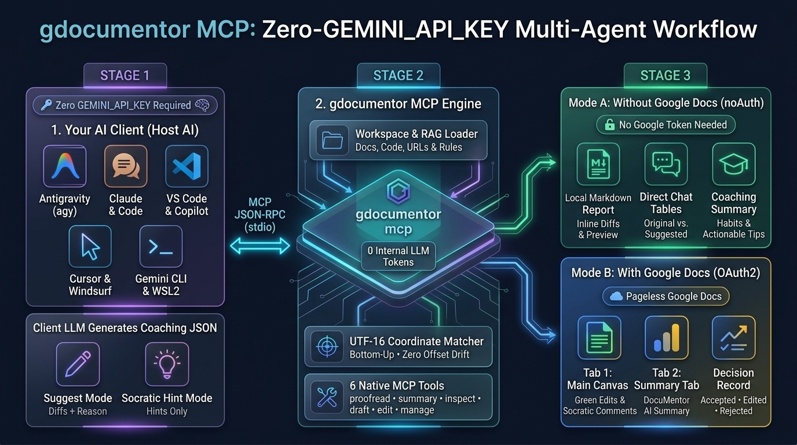

<a name="top"></a>
# 🤖 Multi-Agent & Windows 11 ↔ WSL2 Setup Guide (`gdocumentor`)
### Step-by-Step Guide for Claude Desktop, Claude Code, Cursor, VS Code (GitHub Copilot), Windsurf, Gemini CLI, and Google Antigravity (`agy`)

**[⬅️ Back to Main README](README.md)** | **[👤 Individual Setup (`INSTALL_INDIVIDUAL.md`)](INSTALL_INDIVIDUAL.md)** | **[🏫 School & Organization Setup (`INSTALL_ORGANIZATION.md`)](INSTALL_ORGANIZATION.md)** | **[⚡ 21 One-Command Test Cookbook (`TEST_COMMANDS.md`)](TEST_COMMANDS.md)**

---

## 1. Overview: Why `gdocumentor` Works Seamlessly with Any AI Agent (Without `GEMINI_API_KEY`)



When you run `gdocumentor` as a **standalone CLI tool** (`gdocumentor ...`), it uses its built-in **Gemini API (`GEMINI_API_KEY`)**.  
However, as shown in the workflow infographic above, when you connect `gdocumentor` to an AI agent as an **MCP Server (`gdocumentor mcp`)**:
- **`GEMINI_API_KEY` is NOT required!** Instead of calling an internal Gemini API, `gdocumentor` delegates all proofreading, learning summary, and draft generation reasoning to **your client-side AI agent's own LLM (Host AI, `model: "agent-ai"`)**—such as Claude in Claude Desktop / Claude Code, your active model in Cursor / VS Code (GitHub Copilot) / Windsurf, or Gemini in Antigravity (`agy`) / Gemini CLI.
- `gdocumentor` handles all deterministic work (`0` internal LLM tokens): local file / GitHub / PDF / DOCX loading, `--auto-deps` dependency resolution, RAG rulebooks (`-r`), surrogate-pair-safe bottom-to-top UTF-16 coordinate indexing (`utf16idx`), and **Dual Output Branching**:
  - **Mode A (Without Google Docs — `noAuth: true`):** Requires neither `GEMINI_API_KEY` nor a Google OAuth2 Access Token; writes a local Markdown report (`-o`) and returns structured JSON so the AI agent renders diff tables, rationales, and the Coaching Summary directly in the chat window.
  - **Mode B (With Google Docs — `OAuth2 Enabled`):** Creates or updates a Pageless Google Document with green `WriteMode.SUGGEST` inline edits (or yellow anchored Socratic `--hint` comments), a dedicated `🎓 DocuMentor AI Summary` tab (`summaryTab: true`), and local **Coach Impact & Decision Record** tracking.
- *(Note: Inside an AI agent, `gdocumentor` will only run as a standalone CLI binary requiring `GEMINI_API_KEY` if your prompt **explicitly instructs to use `gdocumentor` as a CLI tool rather than via the MCP server**.)*

| AI Agent / IDE | MCP Config File Configured by `gdocumentor setup` | Skill / Rule / Subagent Files Installed |
| :--- | :--- | :--- |
| **Claude Desktop** | macOS: `~/Library/Application Support/Claude/claude_desktop_config.json`<br>Windows: `%APPDATA%\Claude\claude_desktop_config.json`<br>Linux: `~/.config/Claude/claude_desktop_config.json` (`"mcpServers"`) | 6 Native MCP Tools (`gdocumentor_proofread`, `gdocumentor_summary`, `gdocumentor_inspect`, `gdocumentor_draft`, `gdocumentor_edit`, `gdocumentor_manage`) + Optional Skill ZIP upload |
| **Claude Code** | `~/.claude.json` (user) / `<repo>/.mcp.json` (project) (`"mcpServers"`) | `~/.claude/skills/documentor-ai/SKILL.md`, `~/.claude/agents/gdocumentor-coach.md` |
| **Cursor** | `~/.cursor/mcp.json` (user) / `<repo>/.cursor/mcp.json` (project) (`"mcpServers"`) | `~/.cursor/skills/documentor-ai/SKILL.md`, `.cursor/rules/gdocumentor-workflow.mdc` |
| **VS Code / GitHub Copilot** | macOS: `~/Library/Application Support/Code/User/mcp.json`<br>Windows: `%APPDATA%\Code\User\mcp.json`<br>Linux: `~/.config/Code/User/mcp.json`<br>Project: `<repo>/.vscode/mcp.json` (`"servers"`, `"type": "stdio"`) | `~/.copilot/skills/documentor-ai/SKILL.md`, `.github/skills/documentor-ai/SKILL.md`, `.github/instructions/gdocumentor.instructions.md` |
| **Windsurf** | `~/.codeium/windsurf/mcp_config.json` (`"mcpServers"`) | `~/.codeium/windsurf/skills/documentor-ai/SKILL.md`, `.windsurf/rules/gdocumentor-workflow.md` |
| **Gemini CLI** | `~/.gemini/settings.json` (user) / `<repo>/.gemini/settings.json` (project) (`"mcpServers"`) | `~/.gemini/skills/documentor-ai/SKILL.md` |
| **Google Antigravity (`agy`)** | `agy plugin install https://github.com/tanaikech/gdocumentor` or `~/.gemini/config/mcp_config.json` (`"mcpServers"`) | `~/.gemini/skills/documentor-ai/SKILL.md`, `.agents/skills/documentor-ai/SKILL.md`, `rules/gdocumentor-workflow.md` |

---

## 2. Walkthrough: Using WSL2 `gdocumentor` from Windows 11 Claude Desktop (or Cursor / VS Code / Windsurf)

If you have installed **Claude Desktop on Windows 11** while your development environment and `gdocumentor` live inside **WSL2 (Ubuntu / Debian)**, you can connect Windows 11 Claude Desktop directly to WSL2 `gdocumentor` in **3 simple steps**.

### Step 1: Run the Automatic WSL2 Bridge Command Inside Your WSL2 Terminal
- **🔑 Required Credentials:** `GEMINI_API_KEY`: **Not Required** | Google Docs / Drive OAuth2 Access Token: **Not Required** for setup

Open your **WSL2 terminal** and run:

```bash
# If gdocumentor is not installed in WSL2 yet, install it + configure the Windows 11 host bridge in one command:
curl -fsSL https://raw.githubusercontent.com/tanaikech/gdocumentor/main/scripts/install.sh | bash -s -- --wsl-host --agent claude-desktop,claude-code

# Or if gdocumentor is already installed in WSL2:
gdocumentor setup --wsl-host --agent claude-desktop,claude-code

# (Recommended) Also install the skill inside WSL2's ~/.claude/skills directory:
gdocumentor setup --agent claude-code
```
*(Optional flags: if you have multiple WSL distros or Windows users, you can pass `--wsl-distro Ubuntu-24.04 --win-user <YourWindowsUsername>`.)*

#### What `gdocumentor setup --wsl-host` Does Automatically:
1. **Non-Destructive Update of Windows 11 `claude_desktop_config.json`**:
   - Locates `/mnt/c/Users/<WindowsUser>/AppData/Roaming/Claude/claude_desktop_config.json` (`C:\Users\<WindowsUser>\AppData\Roaming\Claude\claude_desktop_config.json`).
   - Preserves all existing `"preferences"`, `"coworkUserFilesPath"`, and other MCP servers while registering `gdocumentor_server` via `wsl.exe --exec`:
     ```json
     "mcpServers": {
       "gdocumentor_server": {
         "command": "wsl.exe",
         "args": [
           "--exec",
           "/home/<wsl-user>/go/bin/gdocumentor",
           "mcp"
         ]
       }
     }
     ```
2. **Installs Skills (`SKILL.md`) & Subagent (`gdocumentor-coach.md`)**:
   - Places `SKILL.md` and `gdocumentor-coach.md` into both `C:\Users\<WindowsUser>\.claude\skills\documentor-ai\` and WSL2 `~/.claude/skills/documentor-ai/`.
3. **(Optional) Creating a ZIP Package for Claude Desktop GUI's "Upload Skill" Menu**:
   - If you also want to upload `documentor-ai` as a ZIP archive in Claude Desktop's **Settings / Customize ➔ Skills** UI, run this one-liner in WSL2 to create `documentor-ai-skill.zip` in your Windows folder:
     ```bash
     (cd /path/to/gdocumentor/skills && zip -r /mnt/c/Users/<WindowsUser>/Desktop/documentor-ai-skill.zip documentor-ai)
     ```
4. **How `gdocumentor setup --wsl-host` Automatically Detects Your Binary Path & Windows Username (Zero Hardcoded Paths)**:
   - **WSL2 Binary Path Detection (`/home/<wsl-user>/go/bin/gdocumentor` or `~/.local/bin/gdocumentor`)**: At runtime, `gdocumentor` checks `--binary-path`, `exec.LookPath("gdocumentor")`, `os.Executable()`, and fallback candidate paths (`~/go/bin/gdocumentor`, `~/.local/bin/gdocumentor`) to dynamically detect the exact absolute path of the `gdocumentor` binary inside WSL2.
   - **Windows 11 Username & `%APPDATA%` Detection (`/mnt/c/Users/<WindowsUser>/AppData/Roaming`)**: `gdocumentor` resolves the Windows user directory inside WSL2 across three steps:
     1. Checks explicit `--win-user` or `GDOCUMENTOR_WIN_USER` environment variable.
     2. Scans `/mnt/c/Users/` (or `GDOCUMENTOR_WSL_USERS_ROOT`) while filtering out Windows system directories (`Public`, `Default`, `Default User`, `All Users`, `desktop.ini`).
     3. Prefers a Windows profile matching your WSL2 `$USER` or containing `AppData/Roaming`.

---

### Step 2: Completely Restart Claude Desktop on Windows 11

For Claude Desktop on Windows 11 to reload `claude_desktop_config.json`, perform a full exit and restart:
1. In Claude Desktop, click the top-left menu **File ➔ Exit** (or right-click the **Claude icon in the Windows 11 system tray** at the bottom-right of your taskbar and click **Quit / Exit**—simply clicking the window's top-right `×` button may leave Claude running in the background).
2. Launch **Claude Desktop** again.
3. Click the **🔧 (Search and tools)** icon below the chat input box—you will see **`gdocumentor_server`** listed with all 6 tools (`gdocumentor_proofread`, `gdocumentor_summary`, `gdocumentor_inspect`, `gdocumentor_draft`, `gdocumentor_edit`, `gdocumentor_manage`).

---

### Step 3: Try Sample Prompts in Windows 11 Claude Desktop

When Windows 11 Claude Desktop invokes `gdocumentor` inside WSL2:
- **Claude itself acts as the Host AI**, so **`GEMINI_API_KEY` is NOT needed**.
- **Both Windows paths (`C:\Users\...`, `\\wsl.localhost\...`) and WSL2 Linux paths (`/home/...`, `/mnt/c/...`) work automatically!** `gdocumentor` normalizes paths across Windows and WSL2 in-process.
- **Google OAuth2 Credentials (`gcloud` ADC)**: Since `gdocumentor` runs inside WSL2, it automatically uses your WSL2 `~/.config/gcloud/application_default_credentials.json`. (If you logged into `gcloud` on Windows instead of WSL2, you can share the credential with a single symlink inside WSL2: `mkdir -p ~/.config/gcloud && ln -sf "/mnt/c/Users/<WindowsUser>/AppData/Roaming/gcloud/application_default_credentials.json" ~/.config/gcloud/application_default_credentials.json`).

#### Pattern 1-A: Zero-Auth Proofreading Without a Google Docs Access Token (`noAuth: true`)
- **🔑 Required Credentials:** `GEMINI_API_KEY`: **Not Required** (uses Claude's own Host AI via MCP; required *only* if you explicitly instruct in the prompt to run `gdocumentor` as a CLI tool) | Google Docs / Drive OAuth2 Access Token: **Not Required** (`noAuth: true`)
- **🎥 Live Execution Demo Video:** **[Watch on YouTube (`https://youtu.be/2rsLJIUOlJ4`)](https://youtu.be/2rsLJIUOlJ4)**

```text
Please use the gdocumentor_proofread MCP tool without a Google OAuth access token (noAuth: true) to proofread the following short draft. Do not call any external Gemini API; use your own Host AI to generate the structured coaching feedback (`aiResult`). After running the tool, display the complete proofreading results directly here in the chat—including a table of Original Text vs. Suggested Revision, the Reason for each edit, the Learning Point, and the Writing Coach & Learning Summary (Executive Feedback, Observed Habits, and Actionable Tips):

"Google Apps Script is basically a coding platform that is provided by Google. You totally do not need to install any special softwares on your computer at all. The most biggest advantage of using GAS is because it can easily connect and integrate with many various Google services to automate routine works every single day."
```
- **What Happens:** Claude Desktop (`Sonnet 5.5`) generates `aiResult` with zero Gemini API calls, invokes `gdocumentor_proofread` (`noAuth: true`), matches all **5 suggestions** to the text, saves `/tmp/review_report.md` inside WSL2, and displays the **`Original vs. Suggested Revision` Table**, **`Reasons and Learning Points` Table**, **`Revised Paragraph`**, and **`Writing Coach & Learning Summary`** directly in the chat.

#### Pattern 2-A: Proofreading With a Google Docs Access Token (`summaryTab: true` — New Pageless Google Doc + Summary Tab)
- **🔑 Required Credentials:** `GEMINI_API_KEY`: **Not Required** (uses Claude's own Host AI via MCP; required *only* if you explicitly instruct in the prompt to run `gdocumentor` as a CLI tool) | Google Docs / Drive OAuth2 Access Token: **Required** (uses WSL2 `gcloud` ADC)
- **🎥 Live Execution Demo Video:** **[Watch on YouTube (`https://youtu.be/ZTGWwSU9EQg`)](https://youtu.be/ZTGWwSU9EQg)**

```text
Please use the gdocumentor_proofread MCP tool (with Google Docs authentication enabled and summaryTab: true) to proofread the following draft into a new Google Document titled "Claude Desktop WSL2 Test - Coaching Review". After applying the inline Suggested Edits to the Google Document, please show me directly here in the chat:
1. The clickable URL to the created Google Document and its Summary Tab
2. A Markdown table summarizing each inline suggestion applied (Original Text, Suggested Edit, Category, Reason, and Learning Point)
3. The Writing Coach & Learning Summary (Executive Feedback, Observed Habits, and Actionable Tips)

Draft to proofread:
"Google Apps Script is basically a coding platform that is provided by Google. You totally do not need to install any special softwares on your computer at all. The most biggest advantage of using GAS is because it can easily connect and integrate with many various Google services to automate routine works every single day."
```
- **What Happens:** Claude Desktop (`Sonnet 5.5`) generates **7 inline suggestions** in `aiResult` and calls `gdocumentor_proofread` (`summaryTab: true`). Within ~32 seconds, `gdocumentor` creates a Pageless Google Document titled **`Claude Desktop WSL2 Test - Coaching Review`** with 7 `WriteMode.SUGGEST` inline edits + anchored `[DocuMentor AI]` rationale replies on **Tab 1** and a formatted **`🎓 DocuMentor AI Summary`** tab (`Model: agent-ai`, `Issued 7 | Pending AI 7`) on **Tab 2**, and outputs clickable links to both tabs plus the 7-row suggestion table in the chat.

#### Pattern 3: Socratic Hint-Only Coaching (`mode: "hint"`) on Local WSL2 / Windows Files
- **🔑 Required Credentials:** `GEMINI_API_KEY`: **Not Required** (uses Claude's own Host AI via MCP) | Google Docs / Drive OAuth2 Access Token: **Required** (or **Not Required** if you add `noAuth: true`)

```text
Use gdocumentor in Socratic Hint-Only mode (mode: "hint") with the persona "You are a supportive university writing professor" and the rulebook /home/<wsl-user>/GitHub/gdocumentor/sample/rules/writing_guidelines.md to review /home/<wsl-user>/GitHub/gdocumentor/sample/sample_article.md into a new Google Document with a Summary Tab.
```

#### Pattern 4: Reading an Existing Google Document (Text, Tables, Figures, and All Open/Resolved Suggestions & Comments) to Generate a Learning Summary (`gdocumentor_summary`)
- **🔑 Required Credentials:** `GEMINI_API_KEY`: **Not Required** (uses Claude's own Host AI via MCP) | Google Docs / Drive OAuth2 Access Token: **Required**
- Just like the original GAS version, `gdocumentor` can read an existing Google Document—including its prose, tables (`TABLE_1`), figures (`VISUAL_1`), and **all open and resolved inline suggestions and comment threads** (both `🤖 AI` and `👤 Human` reviewer comments)—to synthesize a comprehensive **Writing Coach & Learning Summary** and **Coach Impact & Decision Record** (`✅ Accepted`, `✏️ Edited`, `❌ Rejected`):

```text
Please use the gdocumentor_summary MCP tool to read the existing Google Document "https://docs.google.com/document/d/<YOUR_DOC_ID>/edit" (including its text, tables, figures, and all open and resolved suggestions and comments with includeResolved: true). Synthesize a comprehensive Writing Coach & Learning Summary (Executive Assessment, Revisions Digest, Observed Writing Habits, Actionable Learning Advice, Decision Record, and Thread-by-Thread Takeaways), update the dedicated "🎓 DocuMentor AI Summary" tab in the Google Document (summaryTab: true), and display the full summary directly here in the chat.
```

---

## 3. Walkthrough & Troubleshooting: Using WSL2 `gdocumentor` from Windows 11 VS Code (GitHub Copilot Chat / Agent Mode & Remote-WSL)

If you have **Visual Studio Code (VS Code)** installed on Windows 11 (whether opening Windows folders directly or connecting to WSL2 via the **Remote - WSL** extension), you can register `gdocumentor` in one step.

### Step 1: Run the VS Code Setup Command Inside WSL2
```bash
# 1. Register the WSL2 wsl.exe bridge in Windows 11 VS Code's global MCP config (%APPDATA%\Code\User\mcp.json):
gdocumentor setup --wsl-host --agent vscode

# 2. (Recommended) Also register in WSL2 user scope & current workspace (.vscode/mcp.json, .github/skills/, .github/instructions/) for Remote-WSL windows:
gdocumentor setup --agent vscode --scope both
```
- This non-destructively adds `gdocumentor_server` under the `"servers"` key (`"type": "stdio"`) in `C:\Users\<WindowsUser>\AppData\Roaming\Code\User\mcp.json` (preserving any existing MCP servers) and installs `.github/skills/documentor-ai/SKILL.md` and `.github/instructions/gdocumentor.instructions.md`.

### Step 2: Start & Verify `gdocumentor_server` in VS Code
1. Open the **Chat** panel in VS Code and switch the mode dropdown (bottom-left of the chat input box) from `Ask` or `Edit` to **`Agent`**.
2. Open the Command Palette (**`Ctrl + Shift + P`**), type **`MCP: List Servers`**, select **`gdocumentor_server`**, and click **`Start Server`** (or verify that its status shows **`Running`**).

### 🔧 Troubleshooting Common Issues in VS Code on Windows 11 / Remote-WSL
- **Q1: Why is the Tools (`🔧`) icon not visible in the VS Code chat input box?**
  - **Cause 1 (Chat Mode):** In VS Code, MCP tools are hidden when the chat mode dropdown is set to **`Ask`** or **`Edit`**. Switch the dropdown at the bottom of the chat input box to **`Agent`**.
  - **Cause 2 (`settings.json` flags):** Check your `C:\Users\<WindowsUser>\AppData\Roaming\Code\User\settings.json`. If `"github.copilot.enable"` has `"*": false` or if MCP/Agent features are disabled, ensure `"chat.agent.enabled": true` and `"chat.mcp.enabled": true` are enabled.
- **Q2: Why does clicking `Start Server` on `gdocumentor_server` fail with an error right after opening a new VS Code chat window?**
  - **Root Cause (`Deferred Session Backing` in VS Code 1.145+ / Remote-WSL):** When you open a brand-new empty chat tab in VS Code (especially in `Copilot CLI` / Remote-WSL agent sessions), VS Code defers creating the underlying agent session runtime until the first message is sent. Clicking `Start Server` before sending any message logs:
    `Cannot start an MCP server before the session runtime has been created. Send a message first.`
  - **Solution:** Simply send **one short message** (e.g., `hello`) in the VS Code chat box first! Sending that first message initializes the VS Code agent session runtime, after which `Ctrl + Shift + P` ➔ **`MCP: List Servers`** ➔ **`gdocumentor_server`** ➔ **`Start Server`** immediately succeeds and transitions to **`Running`**.

---

## 4. Native Setup on macOS, Linux, and Native Windows & `gdocumentor setup` Command Reference

If you are running your AI agents natively on the same OS where `gdocumentor` is installed (macOS, Linux, or native Windows PowerShell):
- **🔑 Required Credentials for Setup:** `GEMINI_API_KEY`: **Not Required** | Google Docs / Drive OAuth2 Access Token: **Not Required**

> 💡 **Safe Subcommand Help (`gdocumentor setup` / `--help`) vs. Installing All Clients (`--all` / `-a`)**
> 1. **Viewing Help Safely (`gdocumentor` & `gdocumentor <subcommand> --help`):**
>    - Running `gdocumentor` alone with no arguments displays `gdocumentor --help`.
>    - Running **`gdocumentor setup`** alone (with no flags), **`gdocumentor setup --help`**, or **`gdocumentor setup -h`** displays the detailed `setup` subcommand help—including sample commands and the cross-platform WSL2 ↔ Windows 11 installation guide—**without modifying any configuration files**. (All other subcommands—`proofread`, `summary`, `draft`, `edit`, `manage`, `inspect`, `mcp`—also provide dedicated `--help` / `-h` guides with sample usage.)
> 2. **Installing All 7 Clients Automatically (`--all` / `-a` / `--agent all`):**
>    - Run **`gdocumentor setup --all`** (or `gdocumentor setup -a` / `gdocumentor setup --agent all`) to detect the running `gdocumentor` binary's absolute path via `os.Executable()` and non-destructively configure **all 7 supported AI agents** (`antigravity`, `claude-desktop`, `claude-code`, `cursor`, `vscode`, `windsurf`, `gemini-cli`) in your current OS user home directory—preserving all existing MCP servers and preferences.
> 3. **Cross-Platform Difference: `gdocumentor setup --all` vs. `gdocumentor setup --all --wsl-host`:**
>    - Inside WSL2, `gdocumentor setup --all` (without `--wsl-host`) configures the Linux home directory (`/home/<wsl-user>/...`) for agents running *inside* WSL2, whereas **`gdocumentor setup --all --wsl-host`** (or `gdocumentor setup --agent claude-desktop --wsl-host`) configures the **Windows 11 host** config files (`/mnt/c/Users/<WindowsUser>/AppData/...`) with a `wsl.exe --exec` bridge so Windows GUI apps can invoke the WSL2 binary.

### A. One-Liner Install + Configure All 7 AI Agents
```bash
# macOS / Linux:
curl -fsSL https://raw.githubusercontent.com/tanaikech/gdocumentor/main/scripts/install.sh | bash
```

```powershell
# Windows (PowerShell):
irm https://raw.githubusercontent.com/tanaikech/gdocumentor/main/scripts/install.ps1 | iex
```

### B. Configure All or Specific Agents & Workspace Project Scope (`gdocumentor setup`)
```bash
# Show detailed setup help & cross-platform (WSL2 <-> Windows 11) installation guide:
gdocumentor setup
gdocumentor setup --help

# Configure ALL 7 supported AI agents in user scope (--all / -a / --agent all):
gdocumentor setup --all

# Configure specific agents (comma-separated) in both user and current project (.cursor/, .vscode/, .claude/, .github/) scopes:
gdocumentor setup --agent claude-desktop,claude-code,cursor,vscode,windsurf,gemini-cli --scope both

# From inside WSL2: configure ALL Windows 11 host GUI apps or specific apps via wsl.exe --exec:
gdocumentor setup --all --wsl-host
gdocumentor setup --wsl-host --agent claude-desktop,cursor,vscode,windsurf
```

### C. Checking Status & Clean Uninstallation
```bash
# Inspect current installation status across all agents:
gdocumentor setup --status
gdocumentor setup --wsl-host --status

# Cleanly remove gdocumentor_server from specific agent(s) or all agents while preserving all other MCP servers and settings:
gdocumentor setup --uninstall --agent claude-desktop
gdocumentor setup --uninstall --all
gdocumentor setup --wsl-host --uninstall --agent claude-desktop
```

---

**[⬅️ Back to Main README](README.md)** | **[👤 Individual Setup (`INSTALL_INDIVIDUAL.md`)](INSTALL_INDIVIDUAL.md)** | **[🏫 School & Organization Setup (`INSTALL_ORGANIZATION.md`)](INSTALL_ORGANIZATION.md)** | **[🧪 End-to-End Verification Guide (`TESTING_GUIDE.md`)](TESTING_GUIDE.md)**
