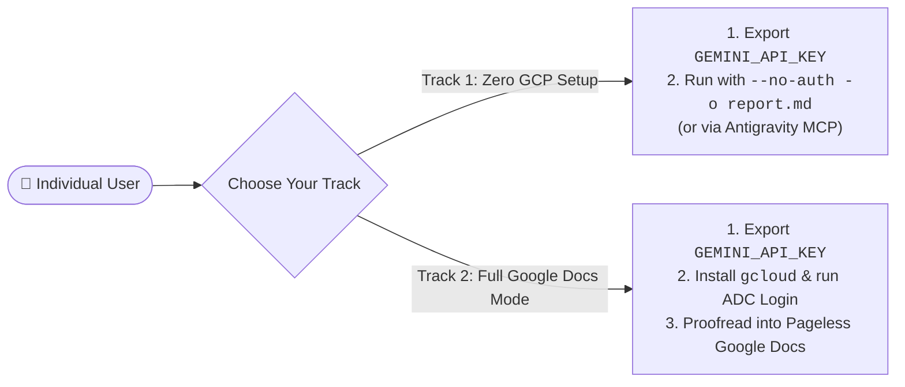

# 👤 Individual Installation & Usage Guide (Personal Setup)

**[⬅️ Back to Main README](README.md)** | **[🏫 Looking for School, University & Organization Deployment? See `INSTALL_ORGANIZATION.md`](INSTALL_ORGANIZATION.md)** | **[⚡ 21 One-Command Test Cookbook (`TEST_COMMANDS.md`)](TEST_COMMANDS.md)**

---

## Overview: Two Flexible Setup Tracks for Individual Users

This guide walks **individual users** (independent writers, bloggers, students, academic researchers, and software engineers) through installing, configuring, and using **`gdocumentor` (`v1.0.1`, DocuMentor AI Go CLI, MCP Server & Antigravity Plugin)**.

Depending on whether you want **instant local proofreading without Google Cloud setup** or **full Google Docs & Drive integration**, you can choose between two personal setup tracks:

| Feature / Requirement | Track 1: **Instant Local & URL Mode (`--no-auth`)**<br>*(Recommended for Quick Start)* | Track 2: **Full Google Docs & Drive Mode (Default)**<br>*(With Personal Google Account)* |
| :--- | :--- | :--- |
| **Required Credentials (CLI)** | **Only `GEMINI_API_KEY`** (from [Google AI Studio](https://aistudio.google.com/apikey)) | **`GEMINI_API_KEY`** + Personal **Google OAuth2 ADC** (`gcloud auth application-default login`) |
| **Required Credentials (MCP / `agy`)** | **None (`0` API keys in `gdocumentor`)** — uses the client AI agent's own LLM (Host AI)! | **Only Personal Google OAuth2 ADC** — uses the client AI agent's own LLM (`GEMINI_API_KEY` not needed)! |
| **`gcloud` CLI & GCP Setup** | **Not Required** (Zero GCP project or OAuth setup) | One-time `gcloud` login & API enablement |
| **Supported Inputs** | Local `.md`, `.docx`, `.txt`, `.html`, source code scripts, `stdin`, public Web URLs, & GitHub URLs (`#Lstart-Lend`, `--repo`) | All Track 1 inputs **plus** existing Google Docs (`-d`), PDF conversion (`-i file.pdf`), & Google Drive RAG folders (`--drive-rag`) |
| **Multimodal Table & Figure Review** | Yes (`TABLE_N` & local/remote Markdown images `VISUAL_N`) | Yes (`TABLE_N` & embedded Google Docs figures `VISUAL_N` anchored directly on the canvas) |
| **Where Results Are Written** | Rich **Local Markdown Coaching Report** (`-o report.md`) in your current working directory | Native **Pageless Google Document** (`WriteMode.SUGGEST` inline cards + `insertComment` + **`🎓 DocuMentor AI Summary`** tab) + optional local report (`-o`) |



---

## Step 1: Install `gdocumentor` (CLI Binary & Antigravity Plugin)

### Prerequisites
- **Gemini API Key**: Obtainable for free or Pay-as-you-go in seconds from **[Google AI Studio (`https://aistudio.google.com/apikey`)](https://aistudio.google.com/apikey)**.
- **Go (Optional if downloading a pre-compiled binary)**: `1.27` or later. Not required if you download a pre-compiled release binary from [GitHub Releases](https://github.com/tanaikech/gdocumentor/releases).

### Option 1A: Download a Pre-Compiled Release Binary (No Go Toolchain Required)
You can download a standalone static binary (`CGO_ENABLED=0`) directly from **[GitHub Releases (`https://github.com/tanaikech/gdocumentor/releases`)](https://github.com/tanaikech/gdocumentor/releases)**:
- **macOS**: `gdocumentor_darwin_arm64` (Apple Silicon M1–M4) or `gdocumentor_darwin_amd64` (Intel)
- **Linux**: `gdocumentor_linux_amd64` (`x86_64` / WSL2) or `gdocumentor_linux_arm64` (`ARM64`)
- **Windows**: `gdocumentor_windows_amd64.exe` (`x86_64`) or `gdocumentor_windows_arm64.exe` (`ARM64`)

```bash
# Example: Linux (x86_64 / amd64)
curl -L https://github.com/tanaikech/gdocumentor/releases/latest/download/gdocumentor_linux_amd64 -o gdocumentor
chmod +x gdocumentor
sudo mv gdocumentor /usr/local/bin/

# Example: macOS (Apple Silicon / arm64)
curl -L https://github.com/tanaikech/gdocumentor/releases/latest/download/gdocumentor_darwin_arm64 -o gdocumentor
chmod +x gdocumentor
sudo mv gdocumentor /usr/local/bin/
```

### Option 1B: Install as a Google Antigravity CLI (`agy`) Plugin & MCP Server
If you use **Google Antigravity CLI (`agy`)**, you can install `gdocumentor` globally (registering the `gdocumentor_server` MCP server, the `documentor-ai` skill, workflow rules, and the `gdocumentor-coach` subagent) with a single command:

```bash
# Install directly from GitHub
agy plugin install https://github.com/tanaikech/gdocumentor

# Or install from a local clone
git clone https://github.com/tanaikech/gdocumentor.git
cd gdocumentor
agy plugin install .

# Verify installation
agy plugin list
```

### Option 1C: Build or Install from Source (Go Toolchain)
```bash
# Clone and build the binary
git clone https://github.com/tanaikech/gdocumentor.git
cd gdocumentor
go build -o gdocumentor .

# (Optional) Move binary into your PATH or install via go install:
go install github.com/tanaikech/gdocumentor@latest
```

---

## Step 2: Configure Your Personal Gemini API Key (For Standalone CLI Mode)

> **💡 CLI vs. MCP Server (`agy`) Note:**
> - **Standalone CLI Mode (`gdocumentor -i ...`)**: Calls the Gemini API directly, so **`GEMINI_API_KEY` is required**.
> - **MCP Server Mode (`gdocumentor mcp` inside Antigravity `agy`, Claude Desktop, Cursor, etc.)**: Uses your **AI agent's own LLM (Host AI)** by default (`model: "agent-ai"`), so **`GEMINI_API_KEY` is NOT required** when invoking `gdocumentor` via MCP tools! The AI agent will only execute `gdocumentor` as a CLI tool (requiring `GEMINI_API_KEY`) when your prompt explicitly instructs to run `gdocumentor` as a CLI tool rather than via the MCP server.

Add your **Gemini API Key** to your shell profile (`~/.bashrc`, `~/.zshrc`, or PowerShell profile) or export it in your terminal session for standalone CLI commands:

```bash
export GEMINI_API_KEY="your-gemini-api-key"

# Optional: Set your preferred default model ("gemini-3.8-flash" is default; also "gemini-4-hydrogen", "gemini-4-carbon", "gemini-4-argon")
export DOCUMENTOR_MODEL="gemini-3.8-flash"
```

---

## Step 3: Choose Your Operating Track

### Track 1: Start Immediately Without Google OAuth (`--no-auth` Local Mode)

- **🔑 Required Credentials (CLI Commands below):** `GEMINI_API_KEY`: **Required** | Google Docs / Drive OAuth2 Access Token: **Not Required** (`--no-auth`)

If you want to start proofreading right away **without installing `gcloud` or configuring a Google Cloud project**, pass `--no-auth` (or `--local`) and specify an output file in your current working directory (`-o ./report.md`):

```bash
# Create an isolated test workspace directory
mkdir -p ~/gdocumentor_try && cd ~/gdocumentor_try

# 1. Proofread a Markdown draft or local script and save the coaching report to ./coaching_report.md
gdocumentor --no-auth -i /path/to/draft.md -o ./coaching_report.md -l en

# 2. Get Socratic Coaching Hints (--hint) so you can practice rewriting the text yourself first
gdocumentor --no-auth -i /path/to/draft.md --hint -o ./socratic_hints.md -l en

# 3. Proofread a live Web article or GitHub source code range (#L15-L60) without cloning
gdocumentor --no-auth -t "https://github.com/tanaikech/DocuMentorAI/blob/main/src/code.js#L15-L60" -o ./code_review.md
```

#### Using Track 1 in Antigravity CLI (`agy`) via the MCP Server
- **🔑 Required Credentials (MCP Server Prompt below):** `GEMINI_API_KEY`: **Not Required** (uses the client AI agent's own Host AI; only required if your prompt explicitly requests running `gdocumentor` as a CLI tool rather than as an MCP server) | Google Docs / Drive OAuth2 Access Token: **Not Required** (`noAuth: true`)

Launch `agy` inside your working directory and enter:
> *"Use the gdocumentor MCP tool without a Google OAuth access token to proofread `./my_draft.md` and save the coaching report to `./my_draft_coaching.md` in the current working directory. Then summarize the top 3 writing habits it found."*

---

### Track 2: Enable Full Google Docs & Drive Integration (`gcloud` ADC Setup)

To create and update **Pageless Google Documents** with interactive inline Suggested Edits (`WriteMode.SUGGEST`), rationale replies, figure/table comments, and **`🎓 DocuMentor AI Summary`** tabs, set up Application Default Credentials (ADC) once on your computer.

> 💡 **Helpful Runtime Guide:** If you ever run a Google Docs command without `gcloud` installed, `gdocumentor` will automatically display concise OS-specific installation and login instructions directly in your terminal.

#### 1. Install the Google Cloud SDK (`gcloud` CLI)
Skip this step if `gcloud` is already installed (`gcloud --version`).

- **Linux / macOS (Official Quick 1-Liner)**:
  ```bash
  curl https://sdk.cloud.google.com | bash
  exec -l $SHELL
  ```
- **Ubuntu / Debian (`apt`)**:
  ```bash
  sudo apt-get update && sudo apt-get install -y apt-transport-https ca-certificates gnupg curl
  curl https://packages.cloud.google.com/apt/doc/apt-key.gpg | sudo gpg --dearmor -o /usr/share/keyrings/cloud.google.gpg
  echo "deb [signed-by=/usr/share/keyrings/cloud.google.gpg] https://packages.cloud.google.com/apt cloud-sdk main" | sudo tee /etc/apt/sources.list.d/google-cloud-sdk.list
  sudo apt-get update && sudo apt-get install -y google-cloud-cli
  ```
- **macOS (Homebrew)**:
  ```bash
  brew install --cask google-cloud-sdk
  ```
- **Windows (PowerShell / `winget`)**:
  ```powershell
  winget install Google.CloudSDK
  ```
  *(Official documentation: [`https://cloud.google.com/sdk/docs/install`](https://cloud.google.com/sdk/docs/install))*

#### 2. Initialize `gcloud` & Enable Required Google APIs
Create or select a personal Google Cloud project and enable the Google Docs, Google Drive, and Generative Language APIs:

```bash
gcloud init
gcloud services enable docs.googleapis.com drive.googleapis.com generativelanguage.googleapis.com
```

#### 3. Log In with Application Default Credentials (ADC)
Run the following command once to save your personal OAuth2 credentials to `~/.config/gcloud/application_default_credentials.json`. `gdocumentor` reads this file natively in-memory with zero subprocess overhead:

```bash
gcloud auth application-default login \
  --scopes="https://www.googleapis.com/auth/documents,https://www.googleapis.com/auth/drive,https://www.googleapis.com/auth/cloud-platform"
```

---

## Step 4: Everyday Personal Usage Examples

### 1. Multimodal Manuscript Proofreading into a New Pageless Google Doc
- **🔑 Required Credentials:** `GEMINI_API_KEY`: **Required** (CLI mode; **Not Required** when invoked via MCP Server) | Google Docs / Drive OAuth2 Access Token: **Required**

Convert a local Markdown (`.md`, including embedded local images and tables), Word (`.docx`), or PDF (`.pdf`) file into a new Pageless Google Document with inline suggestions, rationale replies, and a dedicated **`🎓 DocuMentor AI Summary`** tab:

```bash
gdocumentor -i sample/sample_article.md --summary-tab -o ./article_report.md -l en
```

### 2. In-Place Coaching on an Existing Google Document (`-d`)
- **🔑 Required Credentials:** `GEMINI_API_KEY`: **Required** (CLI mode; **Not Required** when invoked via MCP Server) | Google Docs / Drive OAuth2 Access Token: **Required**

Pass any Google Docs URL or Document ID to apply inline suggestions or Socratic hints (`--hint`) directly to your existing document:

```bash
# Suggest Mode (inline edits + rationale replies + Summary Tab)
gdocumentor -d "https://docs.google.com/document/d/1abc123.../edit" --summary-tab -l en

# Socratic Hint-Only Mode (anchors diagnostic questions without rewriting your text)
gdocumentor -d "https://docs.google.com/document/d/1abc123.../edit" --hint --range "2-5" -l en
```

### 3. Customizing the AI Coach Persona & Style Rulebooks (`--persona`, `-r`)
- **🔑 Required Credentials:** `GEMINI_API_KEY`: **Required** (CLI mode; **Not Required** when invoked via MCP Server) | Google Docs / Drive OAuth2 Access Token: **Required** (unless `--no-auth` is passed)

Tailor the AI coach's identity and enforce your personal or journal style rules:

```bash
gdocumentor -i manuscript.md \
  --persona "You are a senior journal editor specializing in computer science clarity and active voice." \
  -r ./my_style_rules.md \
  --model gemini-4-carbon
```

### 4. Direct Google Docs Editing (`edit` — 0 Gemini Tokens) & Review Cleanup (`manage`)
- **🔑 Required Credentials:** `GEMINI_API_KEY`: **Not Required** (`0` Gemini tokens) | Google Docs / Drive OAuth2 Access Token: **Required**

Edit your Google Docs directly from the terminal (including native Markdown formatting and image insertion/replacement/deletion) or clean up suggestions in bulk without consuming any Gemini API tokens:

```bash
# Append a Markdown file with native headings, bold/code, lists, tables, and images into a Google Doc
gdocumentor edit -d "1abc123..." --append -i ./new_section.md

# Inspect paragraph numbers (#1, #2...), UTF-16 coordinates, and your Coach Impact & Decision Record
gdocumentor inspect -d "1abc123..."

# Accept or reject all pending inline suggestions and delete comments
gdocumentor manage -d "1abc123..." --accept-all
gdocumentor manage -d "1abc123..." --reject-all --delete-comments
```

---

## Step 5: Multi-Agent Setup (Claude Desktop, Claude Code, Cursor, VS Code / GitHub Copilot, Windsurf, Gemini CLI, Antigravity & Windows ↔ WSL2 Bridge)
- **🔑 Required Credentials (MCP Mode):** `GEMINI_API_KEY`: **Not Required** (uses your AI agent's own LLM) | Google Docs / Drive OAuth2 Access Token: **Required** for Google Docs mode (**Not Required** for `noAuth: true` local mode)

You can configure `gdocumentor` (MCP server `gdocumentor_server` + `SKILL.md` + rules + subagents) across all major AI coding and desktop agents in one command:

```bash
# 1. One-Liner Install & Multi-Agent Setup on Linux / macOS / WSL2:
curl -fsSL https://raw.githubusercontent.com/tanaikech/gdocumentor/main/scripts/install.sh | bash

# 2. Or run `gdocumentor setup` directly:
gdocumentor setup --help                                         # View detailed setup & cross-platform WSL2 <-> Windows guide
gdocumentor setup --all                                          # Install for ALL 7 AI agents on current OS
gdocumentor setup --agent claude-desktop,cursor,vscode,claude-code --scope both
gdocumentor setup --status

# 3. Hybrid Windows GUI App (Windows Claude Desktop / Cursor / VS Code / Windsurf) -> WSL2 gdocumentor Bridge:
# Run inside WSL2 to configure Windows host apps to invoke WSL2 gdocumentor via `wsl.exe --exec`:
gdocumentor setup --all --wsl-host
gdocumentor setup --wsl-host --agent claude-desktop,cursor,vscode,windsurf
```

```powershell
# 4. Windows PowerShell One-Liner Install & Multi-Agent Setup:
irm https://raw.githubusercontent.com/tanaikech/gdocumentor/main/scripts/install.ps1 | iex
```

---

**[⬅️ Back to Main README](README.md)** | **[🤖 Multi-Agent & Windows 11 ↔ WSL2 Setup Guide (`INSTALL_AI_AGENTS.md`)](INSTALL_AI_AGENTS.md)** | **[🏫 View School, University & Organization Deployment Guide (`INSTALL_ORGANIZATION.md`)](INSTALL_ORGANIZATION.md)**
