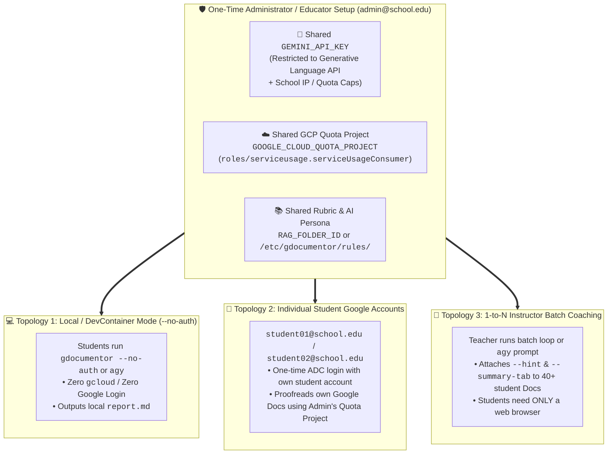

# 🏫 School, University, Research Lab & Organization Deployment Guide

**[⬅️ Back to Main README](README.md)** | **[👤 Looking for Personal Single-User Setup? See `INSTALL_INDIVIDUAL.md`](INSTALL_INDIVIDUAL.md)** | **[🧪 End-to-End Verification Guide (`TESTING_GUIDE.md`)](TESTING_GUIDE.md)**

---

## Overview: Central Admin Configuration with Strict Individual Account Privacy

In K–12 schools, universities, academic research laboratories, and corporate engineering teams using **Google Workspace for Education** or **Google Workspace (Business / Enterprise)**, each educator/administrator (`teacher@school.edu`, `admin@company.com`) and each student or team member (`student01@school.edu`, `student02@school.edu`, ...) has a **distinct individual Google account**.

At the same time, organizations face three practical requirements when adopting an AI writing and code-review coach:
1. **Students / End Users Cannot Manage API Keys or GCP Billing:** Access to Google AI Studio and Google Cloud billing is typically restricted for student Organizational Units (OUs), and asking every student to create a GCP project and enable APIs is impractical.
2. **Strict Privacy & File Ownership Between Students:** Student A (`student01@school.edu`) must only be able to access Student A's own files and Google Documents—never Student B's (`student02@school.edu`) or the instructor's private files.
3. **1-to-N Classroom & Lab Scaling:** Educators and team leads need a way to enforce shared rubrics, coding standards, or AI Coach Personas (`RAG_FOLDER_ID` / `-r`) and optionally deliver Socratic hints (`--hint`) and **`🎓 DocuMentor AI Summary`** tabs (`--summary-tab`) across dozens of student Google Docs in a single batch.

**`gdocumentor` (`v1.1.0`)** natively supports all three requirements **without modifying a single line of application code**, using its built-in separation between:
- **Administrator-Managed Shared Settings**: `GEMINI_API_KEY` (for standalone CLI execution), `GOOGLE_CLOUD_QUOTA_PROJECT` (`X-Goog-User-Project`), and `RAG_FOLDER_ID` (shared rubrics & AI Coach Persona).
- **Host-AI MCP Execution (`gdocumentor mcp`)**: When students or engineers invoke `gdocumentor` as an MCP server from an AI agent (such as **Google Antigravity `agy`**, Claude Desktop, Cursor, or Windsurf), `gdocumentor` uses the **client-side AI agent's own LLM (Host AI)** (`model: "agent-ai"`)—requiring **zero `GEMINI_API_KEY` inside `gdocumentor`** and working with any LLM provider configured in the agent.
- **User-Isolated Document Access**: Local workspace isolation (`--no-auth`), individual student OAuth2 tokens (`student01@school.edu`), or instructor-side batch execution.

---

## Choose Your Organizational Deployment Topology

Select the architecture that best matches your classroom, research lab, or enterprise environment:

| Topology | How Students / Members Work | What the Admin / Teacher Configures Once | Student `gcloud` Setup | Student-to-Student Privacy Isolation |
| :--- | :--- | :--- | :---: | :---: |
| **Topology 1: Zero-Google-Auth Classroom / Coding Lab**<br>(`--no-auth` + Shared `GEMINI_API_KEY`) | Students proofread local `.md`, `.docx`, `.txt`, or code files via CLI or Antigravity (`agy`) into local Markdown reports (`-o`). | Sets `GEMINI_API_KEY` (with IP/API restrictions) and local rulebooks (`/etc/gdocumentor/rules/`) on lab PCs, Linux servers, or DevContainers. | **None**<br>(`gcloud` not needed) | **100% Isolated**<br>(OS user directory / container isolation) |
| **Topology 2: Individual Student Google Accounts + Shared Admin Quota Project**<br>(`GOOGLE_CLOUD_QUOTA_PROJECT` + IAM `Service Usage Consumer`) | Each student uses `gdocumentor` on their own Google Docs (`student01@school.edu` My Drive). | Creates 1 GCP project, grants `roles/serviceusage.serviceUsageConsumer` to `students@school.edu`, and sets `GEMINI_API_KEY` + `GOOGLE_CLOUD_QUOTA_PROJECT`. | **1-Command Login**<br>(`gcloud auth application-default login` with student's own account; zero GCP project creation) | **100% Isolated**<br>(Enforced by each student's own Google Drive OAuth token) |
| **Topology 3: Instructor-Led 1-to-N Batch Coaching on Google Classroom Docs**<br>(Teacher CLI / Antigravity Batch Runner) | Students write in Google Docs in their browser as usual (**zero CLI / zero `gcloud` on student devices**). | Teacher runs `gdocumentor` (from terminal or `agy`) across all submitted student Google Docs URLs to attach Socratic hints (`--hint`) & Summary Tabs (`--summary-tab`). | **None**<br>(Students only use Google Docs in a web browser) | **100% Isolated**<br>(Each student only sees their own Google Classroom Doc) |



---

## Topology 1: Zero-Google-Auth Classroom & Programming Lab (`--no-auth`)

Ideal for computer science classes, writing workshops using Markdown or Word (`.docx`), GitHub Codespaces, DevContainers, or shared Linux servers where you want **zero `gcloud` installation and zero Google OAuth login**.

### 1. Administrator Setup (`/etc/profile.d/gdocumentor.sh` or DevContainer Env)
1. **Install the `gdocumentor` Binary System-Wide (Zero Go Toolchain Needed on Student Machines)**:
   Download the pre-compiled static binary for your lab's OS/architecture from **[GitHub Releases (`https://github.com/tanaikech/gdocumentor/releases`)](https://github.com/tanaikech/gdocumentor/releases)** (`gdocumentor_linux_amd64`, `gdocumentor_linux_arm64`, `gdocumentor_darwin_arm64`, `gdocumentor_darwin_amd64`, `gdocumentor_windows_amd64.exe`, or `gdocumentor_windows_arm64.exe`) and place it in `/usr/local/bin/gdocumentor`:
   ```bash
   # Example for shared Linux servers, DevContainers, or lab workstations (x86_64)
   sudo curl -L https://github.com/tanaikech/gdocumentor/releases/latest/download/gdocumentor_linux_amd64 -o /usr/local/bin/gdocumentor
   sudo chmod +x /usr/local/bin/gdocumentor
   ```
2. Generate an organization **Gemini API Key** (Paid Tier 1+ recommended for concurrent classroom requests; under Google's Paid API terms, student prompts are **never** used to train models).
3. Configure the environment variables and shared rubric directory for all student sessions:
   ```bash
   # /etc/profile.d/gdocumentor.sh (Loaded automatically for all OS users)
   export GEMINI_API_KEY="AIzaSy...(Organization-Gemini-API-Key)"
   # Default: "gemini-3.8-flash" (or "gemini-4-hydrogen", "gemini-4-carbon", "gemini-4-argon")
   export DOCUMENTOR_MODEL="gemini-3.8-flash"
   ```
4. *(Optional)* Place your course rubric and custom AI Coach Persona in a read-only shared directory (e.g., `/etc/gdocumentor/rules/course_rubric.md`):
   ```markdown
   # AI Persona
   You are a supportive university writing instructor. Encourage students to think critically and explain every grammatical or structural principle clearly.

   # Evaluation Rubric
   1. Every claim must be backed by concrete evidence or data from Table 1 / Figure 1.
   2. Avoid passive voice and colloquial intensifiers.
   ```

### 2. Student Usage (Zero Setup Required)
- **🔑 Required Credentials:** `GEMINI_API_KEY`: **Required** (CLI mode) / **Not Required** (when invoked via `agy` MCP server) | Google Docs / Drive OAuth2 Access Token: **Not Required** (`--no-auth`)

Students immediately run `gdocumentor` (or prompt Antigravity CLI `agy`) in their own working directory:
```bash
# Student runs Socratic Hint-Only coaching grounded in the instructor's rubric
gdocumentor --no-auth -i ./my_essay.md -r /etc/gdocumentor/rules/ --hint -o ./my_essay_hints.md
```

---

## Topology 2: Individual Student Google Accounts + Shared Admin Quota Project

Ideal when each student (`student01@school.edu`, `student02@school.edu`, ...) wants to run `gdocumentor` directly against **their own Google Documents on Google Drive** while the school/organization centrally provides the Gemini API key and Google Cloud API quota.

### Why This Preserves 100% Student Privacy
In this topology, **`gdocumentor` separates the Quota Project from the OAuth2 Identity** ([`internal/auth/auth.go`](internal/auth/auth.go)):
- **Billing & API Enablement (`X-Goog-User-Project`)**: Handled by the administrator's `GOOGLE_CLOUD_QUOTA_PROJECT`.
- **Document Access (`Authorization: Bearer <token>`)**: Issued to each individual student (`student01@school.edu`). Student 01 can **only** read and edit documents that `student01@school.edu` owns or has been granted access to in Google Drive. Student 01 can **never** access Student 02's documents.

### Phase 1: One-Time Administrator Setup (5 Minutes)

1. **Create One Shared Google Cloud Project (e.g., `school-gdocumentor-proj`)**:
   ```bash
   gcloud projects create school-gdocumentor-proj --name="School DocuMentor AI"
   gcloud config set project school-gdocumentor-proj

   # Enable the required APIs once on the admin project
   gcloud services enable docs.googleapis.com drive.googleapis.com generativelanguage.googleapis.com
   ```
2. **Grant `Service Usage Consumer` to the Student Group or Domain**:
   Grant **`roles/serviceusage.serviceUsageConsumer`** to your student Google Group (`group:students@school.edu`) or entire Workspace domain (`domain:school.edu`).
   > 🔒 **Least-Privilege Security:** `roles/serviceusage.serviceUsageConsumer` ONLY permits members to use the enabled API quota of `school-gdocumentor-proj`. It grants **zero** access to GCP billing, **zero** access to cloud resources, and **zero** access to anyone else's Google Drive files.
   ```bash
   # Grant to a student Google Group:
   gcloud projects add-iam-policy-binding school-gdocumentor-proj \
     --member="group:students@school.edu" \
     --role="roles/serviceusage.serviceUsageConsumer"

   # Or grant to the entire school Google Workspace domain:
   gcloud projects add-iam-policy-binding school-gdocumentor-proj \
     --member="domain:school.edu" \
     --role="roles/serviceusage.serviceUsageConsumer"
   ```
3. *(Optional)* **Create a Shared Read-Only Google Drive Folder for Course Rubrics (`RAG_FOLDER_ID`)**:
   - Create a Google Drive folder containing course rubrics, style guides, or `# AI Persona` documents.
   - Share the folder with `students@school.edu` as **Viewer (Read-Only)** so students can ground `gdocumentor` in the teacher's rubric without being able to modify the rules.
4. **Distribute the Shared Environment Variables to Student Environments**:
   ```bash
   # /etc/profile.d/gdocumentor.sh (or student setup script)
   export GEMINI_API_KEY="AIzaSy...(School-Gemini-API-Key)"
   export GOOGLE_CLOUD_QUOTA_PROJECT="school-gdocumentor-proj"
   export RAG_FOLDER_ID="1TeacherRubricFolderID..."
   ```

### Phase 2: One-Time Student Login (1 Minute per Student)

Each student simply signs in **once** with their own school Google account (`studentXX@school.edu`)—no `gcloud init`, no GCP project creation, and no API key setup required:

```bash
gcloud auth application-default login \
  --scopes="https://www.googleapis.com/auth/documents,https://www.googleapis.com/auth/drive,https://www.googleapis.com/auth/cloud-platform"
```

After this single browser login, the student can freely run `gdocumentor` (via CLI or Antigravity `agy`) on their own Google Docs and local files:
- **🔑 Required Credentials:** `GEMINI_API_KEY`: **Required** (CLI mode) / **Not Required** (when invoked via `agy` MCP server) | Google Docs / Drive OAuth2 Access Token: **Required** (student's own account)

```bash
# Creates a new Pageless Google Doc in student01@school.edu's own My Drive
gdocumentor -i ./report.md --drive-rag "$RAG_FOLDER_ID" --summary-tab

# Applies Socratic hints to an existing Google Doc owned by student01@school.edu
gdocumentor -d "https://docs.google.com/document/d/1Student01Doc.../edit" --hint --summary-tab
```

---

## Topology 3: Instructor-Led 1-to-N Batch Coaching (Zero CLI Setup for Students)

In many K–12 and university courses (such as essay writing, literature, or lab reports via **Google Classroom**), students work exclusively inside Google Docs on Chromebooks, tablets, or browsers and do not use a terminal at all.

With `gdocumentor`, **only the instructor (teacher/professor)** installs `gdocumentor` (using [Individual Track 2](INSTALL_INDIVIDUAL.md)). When students submit or share their Google Docs inside a Google Classroom assignment folder, the instructor can coach the entire class at once:

### Example: Batch Delivering Socratic Hints & Summary Tabs to an Entire Class

- **🔑 Required Credentials (CLI Batch Loop below):** `GEMINI_API_KEY`: **Required** | Google Docs / Drive OAuth2 Access Token: **Required** (instructor's account)

```bash
# Instructor runs a batch loop over student Google Docs URLs / IDs
for doc_id in \
  "1StudentA_DocID..." \
  "1StudentB_DocID..." \
  "1StudentC_DocID..."
do
  gdocumentor -d "$doc_id" \
    --hint \
    -r ./course_rubric.md \
    --persona "You are a warm, encouraging high school writing teacher. Give Socratic hints that help the student discover how to improve their thesis and evidence." \
    --summary-tab
done
```
Or simply ask **Google Antigravity CLI (`agy`)**:
- **🔑 Required Credentials (MCP Server Prompt below):** `GEMINI_API_KEY`: **Not Required** (uses the client AI agent's own Host AI; only required if your prompt explicitly requests running `gdocumentor` as a CLI tool rather than via the MCP server) | Google Docs / Drive OAuth2 Access Token: **Required** (instructor's account)
> *"Using the gdocumentor MCP tool, review each student Google Doc listed in `./student_docs.txt` in Socratic Hint-Only mode (`mode: "hint"`) using `./course_rubric.md` as the RAG rulebook, and create a `🎓 DocuMentor AI Summary` tab (`summaryTab: true`) in each student's document."*

**What Students Experience:**
- When each student opens their Google Document in a web browser, they immediately find anchored **💡 Socratic Coaching Hints** on their sentences/tables/figures and a dedicated **`🎓 DocuMentor AI Summary`** tab summarizing their writing habits and next steps—with **zero software installation and zero API key access on the student side**.

---

## Security & Budget Protection Best Practices for Administrators

When deploying a shared `GEMINI_API_KEY` in a school or enterprise environment, apply the following safeguards in the **[Google Cloud Console > APIs & Services > Credentials](https://console.cloud.google.com/apis/credentials)**:

1. **Restrict the API Key to `Generative Language API` Only:**
   - Under **API restrictions**, select **Restrict key** and check **only** `Generative Language API`. Even if a key string is viewed, it cannot be used to access any other Google Cloud service.
2. **Restrict by School / Campus IP Address (Application Restrictions):**
   - Under **Application restrictions**, select **IP addresses** and enter your school campus's outbound public IP / CIDR ranges (or your shared Linux server / VDI / Cloud NAT IP). Requests from outside the school network will be automatically rejected (`403 Forbidden`).
3. **Configure Per-Minute & Daily Quota Caps:**
   - Under **APIs & Services > Generative Language API > Quotas & System Limits**, set sensible requests-per-minute (RPM) and daily token ceilings to prevent runaway scripts or unexpected billing spikes.
4. **Optional Zero-Key-Exposure Reverse Proxy (`--gemini-base-url`):**
   - If you want **zero raw API key strings** to exist on student machines, `gdocumentor` supports `--gemini-base-url <proxy-url>` (and `geminiBaseUrl` in MCP). You can run a lightweight internal reverse proxy (e.g., Nginx or Cloud Run) that injects the `x-goog-api-key` header server-side, while student machines only pass `GEMINI_API_KEY="school-proxy"` and `--gemini-base-url "https://gemini-proxy.internal.school.edu"`.

---

**[⬅️ Back to Main README](README.md)** | **[👤 View Individual Personal Setup Guide (`INSTALL_INDIVIDUAL.md`)](INSTALL_INDIVIDUAL.md)** | **[🤖 Multi-Agent & Windows 11 ↔ WSL2 Setup Guide (`INSTALL_AI_AGENTS.md`)](INSTALL_AI_AGENTS.md)**
