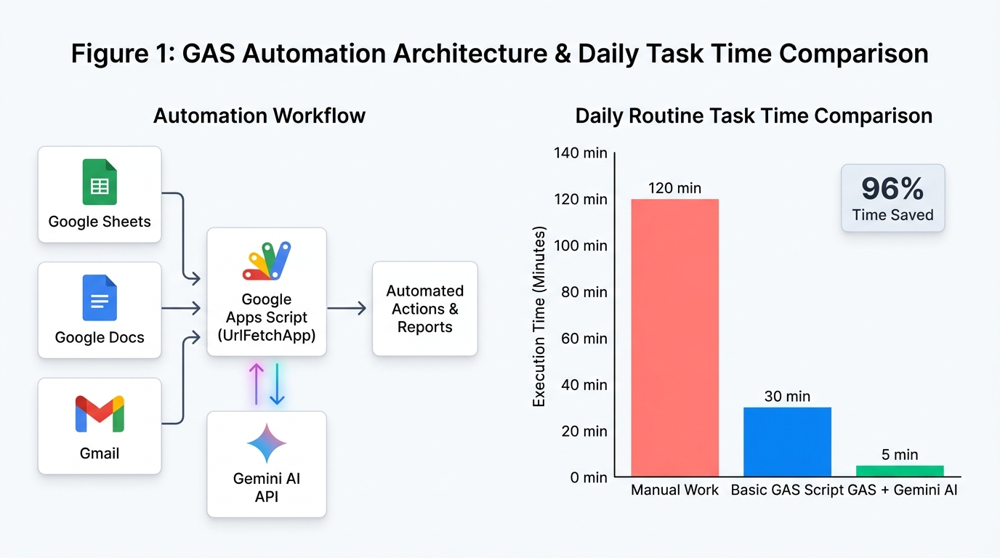

# 🧪 End-to-End Verification & Feature Testing Guide (`gdocumentor`)

**[⬅️ Back to Main README](README.md)** | **[⚡ 21 One-Command Test Cookbook (`TEST_COMMANDS.md`)](TEST_COMMANDS.md)** | **[🤖 Agent Skill Specification (`skills/documentor-ai/SKILL.md`)](skills/documentor-ai/SKILL.md)** | **[📋 JSON I/O Schema (`skills/documentor-ai/references/json_schema.md`)](skills/documentor-ai/references/json_schema.md)**

---

## Overview

This step-by-step testing guide provides **self-contained, hands-on test scenarios** designed so that any developer, technical writer, educator, researcher, or AI agent engineer can systematically verify **all features of `gdocumentor` (DocuMentor AI Go CLI, Global MCP Server & Antigravity Agent Skill Edition)**.

> **💡 Want quick one-liner commands instead?** See **[⚡ `TEST_COMMANDS.md` (21 Self-Contained One-Command Tests)](TEST_COMMANDS.md)** for 21 copy-pasteable single-command tests (Part 1: `#1–#9` without a Google OAuth2 Access Token using `--no-auth`; Part 2: `#10–#21` with a Google OAuth2 Access Token and automatic `--delete-doc` cleanup).

Every test scenario below is **100% self-contained**: it includes ready-to-copy shell commands that create any required sample manuscripts, source code files, or RAG rulebooks inside an isolated temporary directory (`/tmp/gdocumentor_test_*`), execute `gdocumentor`, verify the expected results, and **automatically clean up both local temporary files (`rm -rf "$TEST_DIR"`) and the temporary Google Document created on Google Drive (`./gdocumentor manage -d "$DOC_ID" --delete-doc`)** upon completion.

### Quick Summary of the 13 Test Scenarios

| Test # | Feature Under Test | Required Credentials (`GEMINI_API_KEY` / Google OAuth2 Access Token) | Key Capabilities Verified | Est. Time |
| :--- | :--- | :--- | :--- | :--- |
| **[Test 1](#test-1--environment-native-adc-auth-bilingual-output--model-switching)** | Environment, Native ADC Auth, Bilingual Output (`-l en`/`ja`) & Model Switching | **`GEMINI_API_KEY`: Required**<br/>**Access Token: Required** (Steps 3–4) / **Not Required** (Step 5 `--no-auth`) | Native in-process OAuth2/ADC, Quota Project resolution, `--model gemini-3.8-flash` vs. `gemini-4-hydrogen` / `gemini-4-carbon` / `gemini-4-argon`, Pageless mode, and automated unit/integration test suite | 1 min |
| **[Test 2](#test-2--initial-draft-generation--blank-document-auto-detection)** | `draft` Subcommand & Blank Google Document Auto-Detection | **`GEMINI_API_KEY`: Required**<br/>**Access Token: Required** | Generating clean plain-text drafts from a prompt (`WriteMode.EDIT`) into a new Pageless or existing blank Google Document | 1 min |
| **[Test 3](#test-3--full-document-multimodal-proofreading-prose--table--figure)** | Full-Document Multimodal Proofreading (`sample/sample_article.md` + `sample/sample_figure.png`) | **`GEMINI_API_KEY`: Required**<br/>**Access Token: Required** | Native Markdown-to-Pageless-Google-Docs conversion with Base64 image embedding (and Drive `thumbnailLink` `=s2048` fallback), inline `WriteMode.SUGGEST`, `TABLE_1` & `VISUAL_1` multimodal review comments, and existing Google Doc (`-d`) `contentUri` image analysis | 2 min |
| **[Test 4](#test-4--active-self-revision-coaching-socratic-hint-only-mode)** | `💡 Hint-Only Mode` (`--mode hint` / `--hint`) | **`GEMINI_API_KEY`: Required**<br/>**Access Token: Required** | Anchored coaching hint comments (`insertComment`) with **🎯 Flagged Phrase**, **💡 Issue**, and **🎓 Coaching Hint**—without spoiling the rewrite | 2 min |
| **[Test 5](#test-5--multi-file-review-partial-linechar-range-scoping--auto-dependency-resolution)** | Multi-File Review, Partial Ranges (`-t`, `--range`) & `--auto-deps` | **`GEMINI_API_KEY`: Required**<br/>**Access Token: Required** | `=== [File: ...] ===` headers, line-range (`file.go:15-45`) & char-range (`doc.md@80:260`) scoping, and automatic Go/JS/Markdown dependency context | 2 min |
| **[Test 6](#test-6--strict-fail-closed-selection-scope-boundary-synthetic-marker-regression-test)** | **Strict Fail-Closed Selection Scope Boundary** | **`GEMINI_API_KEY`: Required**<br/>**Access Token: Required** | Confirming that out-of-scope lines and out-of-scope review threads (`SYNTHETIC_OUT_OF_SELECTION_MARKER_999`) are 100% excluded from editable blocks | 2 min |
| **[Test 7](#test-7--context-aware--enterprise-grounded-rag-local--google-drive-folderfile-prose--code-review)** | **Hybrid RAG Grounding & Custom AI Persona (`-r`, `--rules-dir`, `--drive-rag`, `--persona`)** | **`GEMINI_API_KEY`: Required**<br/>**Access Token: Required** | Custom AI Persona / Positioning (`# AIの位置づけ` / `--persona`), inline XML `<organization_rules>`, parallel Gemini File API upload (`defer DELETE`) for PDFs, and rulebook-grounded **Prose (Part A)**, **Script Review (Part B)** & **Japanese Professor Persona (Part C)** | 4 min |
| **[Test 8](#test-8--proofreading-directly-from-web-article-urls--github-repository--script-urls)** | **Direct Web URL & GitHub Repository / Script URL Proofreading** | **`GEMINI_API_KEY`: Required**<br/>**Access Token: Required** | HTML article extraction (`-i https://...`), GitHub blob line-anchor URLs (`#L1-L35`), `--repo` shallow-clone partial script review, and `curl` stdin piping | 3 min |
| **[Test 9](#test-9--resolved-review-history-learning-summary-summary-batch-canvas-cleanup-manage--coach-decision-record)** | Standalone Learning Summary (`summary`), Batch Cleanup (`manage`) & **Coach Impact & Decision Record** | **`GEMINI_API_KEY`: Required** (`proofread`/`summary`) / **Not Required** (`inspect`/`manage`)<br/>**Access Token: Required** | Synthesizing lessons from open + resolved threads (`--include-resolved`), tracking `🤖 AI` vs. `👤 Human` provenance, `Accepted`/`Edited`/`Rejected`/`Expired` reconciliation, and `--accept-all`, `--reject-all`, `--delete-comments`, `--reset-record`, `--delete-doc` | 2 min |
| **[Test 10](#test-10--antigravity-plugin--global-mcp-server-gdocumentor-mcp--strict---json--input-json-stream-separation)** | **Antigravity Plugin, Global MCP Server (`gdocumentor mcp`) & Strict `--json` Mode** | **`GEMINI_API_KEY`: Required** (for `run_documentor.sh` CLI wrapper) / **Not Required** (for `gdocumentor mcp`)<br/>**Access Token: Required** | Verifying `agy plugin validate --strict .` (`mcpServers 1`), JSON-RPC 2.0 MCP Server tools (`initialize`, `tools/list`, `tools/call`), `run_documentor.sh`, and zero ANSI/spinner contamination on `stdout` | 2 min |
| **[Test 11](#test-11--access-token-free-local-mode---no-auth-mcp-noauth-true--dual-output--o--save-local-with-access-token)** | **Access-Token-Free Mode (`--no-auth` / MCP `noAuth: true`) & Dual Local Output (`-o <file>` / `--save-local` with Access Token)** | **`GEMINI_API_KEY`: Required** (CLI) / **Not Required** (MCP)<br/>**Access Token: Not Required** (Steps 1–2 `--no-auth`) / **Required** (Step 3 Dual Output) | Verifying local Markdown report generation without an Access Token (CLI & MCP) AND simultaneous Pageless Google Doc + local Markdown file output when using an Access Token | 2 min |
| **[Test 12](#test-12--direct-google-docs-editing-edit-subcommand-create-delete-plainmarkdown-insert-via-file--pipe--here-string--heredoc--redirect-image-insertreplacedelete-replace--delete-ranges--0-gemini-tokens)** | **Direct Google Docs Editing (`edit` Subcommand: Create, Delete, Plain/Markdown Insert, Image Insert/Replace/Delete, Replace & Delete Ranges — 0 Gemini Tokens)** | **`GEMINI_API_KEY`: Not Required** (`0` tokens)<br/>**Access Token: Required** | `--create-doc`, `--delete-doc`, `--markdown` (headings, bold/italic/code/links, lists, tables, images), `--insert-image`/`--replace-image`/`--delete-image`, `--prepend`/`--append`/`--at`/`--before`/`--after`/`--before-paragraph`/`--after-paragraph`, pipe `\|`, `<<<`, `<<EOF`, `<`, `--find`/`--replace`, `--delete-range`/`--delete-text`/`--clear` | 2 min |
| **[Test 13](#test-13--dual-ai-execution-architecture-mcp-host-ai-engine-vs-internal-gemini-api-fallback--agy--p-non-interactive-verification)** | **Dual AI Execution Architecture (MCP Host-AI Engine vs. Internal Gemini API Fallback & `agy -p` Verification)** | **`GEMINI_API_KEY`: Not Required** (MCP Host-AI default)<br/>**Access Token: Not Required** (`noAuth: true`) | Zero-`GEMINI_API_KEY` MCP 1-Step Fast Path & 2-Step Prepare/Apply, `useInternalGemini: true` / `DOCUMENTOR_MCP_USE_INTERNAL_GEMINI=1` rollback, and non-interactive `agy -p --dangerously-skip-permissions` E2E verification | 2 min |

---

## Test 1 — Environment, Native ADC Auth, Bilingual Output & Model Switching

- **🔑 Required Credentials:** `GEMINI_API_KEY`: **Required** | Google Docs / Drive OAuth2 Access Token: **Required** (for Steps 3–4 & 6; **Not Required** for Step 5 `--no-auth`)

### Objective
Verify that `gdocumentor` builds cleanly, passes all unit and integration tests, resolves Google Workspace OAuth2 credentials (via native in-process ADC) and `GEMINI_API_KEY`, and supports switching between **`gemini-3.8-flash`** (fast default), **`gemini-4-hydrogen`** (`--model hydrogen`), **`gemini-4-carbon`** (`--model carbon`), **`gemini-4-argon`** (`--model argon`), and English (`-l en`) / Japanese (`-l ja`) coaching output.

### Self-Contained Procedure

```bash
# 1. Build the gdocumentor binary (or download from GitHub Releases) and verify version & help output
go build -o gdocumentor .
./gdocumentor --version
./gdocumentor --help

# 2. Run the complete automated unit & integration test suite
go test -count=1 -v ./...

# 3. Verify quick single-sentence proofreading via stdin pipe in English (gemini-3.8-flash)
DOC_1A=$(echo "DocuMentor ai is basically a very unique tool that helps engineers improve their code works." \
  | ./gdocumentor -i - --title "Test 1A - EN Flash Check" -l en --model gemini-3.8-flash | tee /dev/stderr | sed -n 's/.*Document ID: *\([a-zA-Z0-9_-]*\).*/\1/p' | tail -n 1)

# 4. Verify Japanese coaching output with the deep reasoning model (gemini-4-argon)
DOC_1B=$(echo "DocuMentor ai is basically a very unique tool that helps engineers improve their code works." \
  | ./gdocumentor -i - --title "Test 1B - JA Argon Check" -l ja --model gemini-4-argon | tee /dev/stderr | sed -n 's/.*Document ID: *\([a-zA-Z0-9_-]*\).*/\1/p' | tail -n 1)

# 5. Verify Access-Token-Free Local Mode (--no-auth) using ONLY GEMINI_API_KEY
GOOGLE_OAUTH_ACCESS_TOKEN="invalid" ./gdocumentor --no-auth -i sample/sample_article.md -o /tmp/test_1c_noauth.md -l ja && rm -f /tmp/test_1c_noauth.md

# 6. Clean up created Google Documents on Google Drive after inspecting them
./gdocumentor manage -d "$DOC_1A" --delete-doc
./gdocumentor manage -d "$DOC_1B" --delete-doc
```

### Expected Result
- `go test -count=1 -v ./...` passes all 6 internal packages (`auth`, `cli`, `gdocs`, `gemini`, `utf16idx`, `workspace`).
- Step 3 creates a new Google Document with English coaching rationales (`[DocuMentor AI | ...] 💡 Reason for Revision` / `🎓 Learning Point`).
- Step 4 creates a new Google Document with Japanese coaching rationales (`【DocuMentor AI｜...】 💡 推敲の理由` / `🎓 学習ポイント`) using `gemini-4-argon`.
- Step 5 runs completely without a valid Google OAuth2 Access Token (`--no-auth`), proofreading `sample/sample_article.md` (including `TABLE_1` and `VISUAL_1`) and writing `/tmp/test_1c_noauth.md`.

---

## Test 2 — Initial Draft Generation & Blank Document Auto-Detection

- **🔑 Required Credentials:** `GEMINI_API_KEY`: **Required** (CLI mode) | Google Docs / Drive OAuth2 Access Token: **Required**

### Objective
Verify that `gdocumentor draft` generates a structured plain-text initial draft (without markdown code fences) into a newly created Google Document (`WriteMode.EDIT`), and that running `gdocumentor proofread` on a blank existing Google Document with `--prompt` automatically switches to initial draft generation.

### Self-Contained Procedure

```bash
# 1. Generate an initial 2-paragraph draft into a brand-new Pageless Google Document
DOC_ID=$(./gdocumentor draft \
  --title "Test 2 - Executive Summary Draft" \
  -l en \
  -p "Write a short, two-paragraph executive summary about the benefits of combining automated testing with peer code reviews in software engineering teams." \
  | tee /dev/stderr | sed -n 's/.*Document ID: *\([a-zA-Z0-9_-]*\).*/\1/p' | tail -n 1)

# 2. Clean up the temporary Google Document on Google Drive after inspecting it
./gdocumentor manage -d "$DOC_ID" --delete-doc
```

### Expected Result
- **Terminal TUI**: Displays `📝 Initial Draft Generated & Inserted` with a preview of the generated paragraphs and the clickable **Google Document URL**.
- **On the Google Docs Canvas**: Two clean paragraphs of plain text are inserted directly at index `1` (`WriteMode.EDIT`), ready for subsequent proofreading via `./gdocumentor -d "<DOC_ID>"`.

---

## Test 3 — Full-Document Multimodal Proofreading (Prose + Table + Figure)

- **🔑 Required Credentials:** `GEMINI_API_KEY`: **Required** (CLI mode) | Google Docs / Drive OAuth2 Access Token: **Required**

### Objective
Verify the 4-stage multimodal proofreading pipeline using the bundled [`sample/sample_article.md`](sample/sample_article.md) and [`sample/sample_figure.png`](sample/sample_figure.png):
1. **Local Markdown + Image -> Native Google Docs Conversion**: `gdocumentor` embeds `sample/sample_figure.png` as a Base64 Data URI (`data:image/...;base64,...`) in parallel and uploads the Markdown to Google Drive API v3 (`mimeType: "application/vnd.google-apps.document"`), natively converting the Markdown table into a Google Docs Table (`TABLE_1`) and the Base64 image into a Google Docs `inlineObject` (`VISUAL_1`) (with an automatic Google Drive upload + `thumbnailLink` `=s2048` + `insertInlineImage` fallback if needed).
2. **Multimodal Review**: Applies inline suggestions (`WriteMode.SUGGEST` + `addCommentReply`) to body prose and anchors 3-tier fallback comments (`insertComment`) directly onto `TABLE_1` and `VISUAL_1`.
3. **Existing Google Doc (`-d`) Embedded Image Analysis**: When re-reading the existing Google Document via `-d <DOC_ID>`, `gdocumentor` downloads the embedded image binary from `inlineObjects[id].inlineObjectProperties.embeddedObject.imageProperties.contentUri` (with OAuth2 Bearer fallback) and analyzes it with Gemini.

### Self-Contained Procedure

```bash
# 1. Run full-document multimodal proofreading on the bundled sample (Markdown + Table + Figure)
#    and capture the created Google Document ID
DOC_ID=$(./gdocumentor -i sample/sample_article.md \
  --title "Test 3 - Multimodal Sample Proofreading (Prose + Table + Figure)" \
  -l ja \
  --mode suggest \
  --json | jq -r '.documentId')
echo "Created Google Doc ID: $DOC_ID"

# 2. Inspect the converted Google Document structure to verify that EditableBlocks (including table cells),
#    inline suggestions, and anchored comments on TABLE_1 and VISUAL_1 were created
./gdocumentor inspect -d "$DOC_ID" -l ja

# 3. Verify Existing Google Doc (-d) Embedded Image URL Fetching & Multimodal Analysis
./gdocumentor summary -d "$DOC_ID" -l ja

# 4. Clean up the temporary Google Document on Google Drive after inspecting it
./gdocumentor manage -d "$DOC_ID" --delete-doc
```

### Expected Result
- **Step 1**: Converts `sample/sample_article.md` + `sample/sample_figure.png` into a native Google Document containing body headings/paragraphs, a 3x4 Google Docs table (`TABLE_1`), and the embedded workflow architecture/chart image (`VISUAL_1`).
- Awkward phrases (*"most biggest"*, *"many various"*, *"daily routine works"*, *"special softwares"*, *"merit"*, *"very recommended"*) are converted into native **Google Docs Inline Suggestions (`WriteMode.SUGGEST`)** in descending `StartIndex` order with attached **DocuMentor AI** coaching replies (`addCommentReply`).
- Both `TABLE_1` and `VISUAL_1` receive anchored review comments (`insertComment`) comparing the 3-bar chart (`Manual Work: 120 min`, `GAS: 30 min`, `GAS + Gemini: 5 min`) with the 2-row table (`30 min`, `5 min`).
- **Step 3 (`-d "$DOC_ID"`)**: Downloads `VISUAL_1` directly from the Google Docs `contentUri` URL, uploads it to the Gemini File API (cleaning it up via `defer`), and synthesizes the **🎓 Writing Coach & Learning Summary**.

---

## Test 4 — Active Self-Revision Coaching (Socratic `💡 Hint-Only Mode`)

- **🔑 Required Credentials:** `GEMINI_API_KEY`: **Required** (CLI mode) | Google Docs / Drive OAuth2 Access Token: **Required**

### Objective
Verify that **💡 Hint-Only Mode (`--mode hint` or `--hint`)** creates **zero** inline text replacements (`WriteMode.SUGGEST`) on the Google Docs canvas and instead anchors Socratic coaching hints via `insertComment` so the author can practice rewriting the text themselves.

### Self-Contained Procedure

```bash
# 1. Create a self-contained sample paragraph with common academic writing issues
TEST_DIR=$(mktemp -d /tmp/gdocumentor_test4_XXXXXX)
cat << 'EOF' > "$TEST_DIR/lab_draft.txt"
In our research laboratory, we are basically conducting many various experiments every single day in order to evaluate the most best parameters for our machine learning model. However, collecting experimental data informations manually by hand takes a very long time and causes many careless human mistakes.
EOF

# 2. Run gdocumentor in Socratic Hint-Only Mode (--hint)
DOC_ID=$(./gdocumentor -i "$TEST_DIR/lab_draft.txt" \
  --title "Test 4 - Socratic Hint-Only Mode" \
  --hint \
  -l en | tee /dev/stderr | sed -n 's/.*Document ID: *\([a-zA-Z0-9_-]*\).*/\1/p' | tail -n 1)

# 3. Clean up temporary Google Doc on Google Drive and local directory
./gdocumentor manage -d "$DOC_ID" --delete-doc
rm -rf "$TEST_DIR"
```

### Expected Result
- **On the Google Docs Canvas**: **Zero green/strikethrough inline edits (`WriteMode.SUGGEST`) are created.**
- Instead, flagged phrases (*"many various"*, *"most best"*, *"data informations"*, *"manually by hand"*) are highlighted with anchored **Google Docs Comments (`insertComment`)** formatted as:
  - `[DocuMentor AI | 💡 Hint Mode: <Category>]`
  - `🎯 Flagged Phrase: "..."`
  - `💡 Issue to Check: ...`
  - `🎓 Coaching Hint (Try Rewriting Yourself!): ...`

---

## Test 5 — Multi-File Review, Partial Line/Char Range Scoping & Auto-Dependency Resolution

- **🔑 Required Credentials:** `GEMINI_API_KEY`: **Required** (CLI mode) | Google Docs / Drive OAuth2 Access Token: **Required**

### Objective
Verify that `gdocumentor`:
1. Automatically discovers imported packages (`--auto-deps`) as read-only `<reference_context_files>` to detect cross-file signature or naming inconsistencies.
2. Restricts inline suggestions strictly to the specified line range (`-t "main.go:8-13"`) or character range (`@start:end`) while inserting the full file into Google Docs for visual context.

### Self-Contained Procedure

```bash
# 1. Create a mini multi-file Go project in a temporary directory
TEST_DIR=$(mktemp -d /tmp/gdocumentor_test5_XXXXXX)
mkdir -p "$TEST_DIR/internal/formatter"

cat << 'EOF' > "$TEST_DIR/go.mod"
module example.com/salestool

go 1.27
EOF

# Dependency file (will be auto-discovered via --auto-deps as Read-Only context)
cat << 'EOF' > "$TEST_DIR/internal/formatter/formatter.go"
package formatter

import "fmt"

// FormatCurrency formats an amount in USD (expects dollars, not cents).
func FormatCurrency(amountUSD float64) string {
	return fmt.Sprintf("$%.2f USD", amountUSD)
}
EOF

# Target file with intentional issues on lines 9-14
cat << 'EOF' > "$TEST_DIR/main.go"
package main

import (
	"fmt"
	"example.com/salestool/internal/formatter"
)

func main() {
	var raw_price_in_cents float64 = 1999
	if raw_price_in_cents == 1999 {
		msg := formatter.FormatCurrency(raw_price_in_cents)
		fmt.Println("Total price is: " + msg)
	}
}
EOF

# 2. Proofread ONLY lines 9-14 of main.go with --auto-deps enabled
DOC_ID=$(cd "$TEST_DIR" && "$OLDPWD/gdocumentor" \
  -t "main.go:9-14" \
  --auto-deps \
  --title "Test 5 - Partial Line Scope + Auto-Deps" \
  -l en \
  -p "Check variable naming conventions (snake_case vs camelCase) and verify whether raw_price_in_cents matches the unit expected by formatter.FormatCurrency." \
  | tee /dev/stderr | sed -n 's/.*Document ID: *\([a-zA-Z0-9_-]*\).*/\1/p' | tail -n 1)

# 3. Clean up temporary Google Doc on Google Drive and local project
./gdocumentor manage -d "$DOC_ID" --delete-doc
rm -rf "$TEST_DIR"
```

### Expected Result
- **Step 1**: Automatically resolves `internal/formatter/formatter.go` (`ContextFiles=1`) without needing `-c`.
- **Step 2 & Step 3**: Gemini detects both the `snake_case` naming (`raw_price_in_cents`) AND the unit mismatch (`cents` passed to `FormatCurrency(amountUSD)` defined in `formatter.go`), while restricting inline suggestions strictly to **lines 9–14** of `main.go`.

---

## Test 6 — Strict Fail-Closed Selection Scope Boundary (Synthetic Marker Regression Test)

- **🔑 Required Credentials:** `GEMINI_API_KEY`: **Required** (CLI mode) | Google Docs / Drive OAuth2 Access Token: **Required**

### Objective
Verify the **Fail-Closed Selection Scope Boundary**: when a partial line or character range is specified (`-t` or `--range`), lines outside the target range must **never** receive inline suggestions (`TargetEditable: false`), and out-of-scope review threads (`SYNTHETIC_OUT_OF_SELECTION_MARKER_999`) are 100% excluded.

### Self-Contained Procedure

```bash
# 1. Create a 2-paragraph file where Line 1 has an intentional error (out of scope)
#    and Line 3 has an intentional error (in scope: lines 3-3)
TEST_DIR=$(mktemp -d /tmp/gdocumentor_test6_XXXXXX)
cat << 'EOF' > "$TEST_DIR/scope_test.md"
Paragraph 1 (OUT OF SCOPE): SYNTHETIC_OUT_OF_SELECTION_MARKER_999 This paragraph has a very unique and most biggest grammar mistake that MUST NOT be edited.

Paragraph 2 (IN SCOPE): The most biggest advantage of GAS is that you totally do not need special softwares at all to automate daily routine works.
EOF

# 2. Target strictly Line 3 (-t "scope_test.md:3-3") and inspect JSON output
./gdocumentor -t "$TEST_DIR/scope_test.md:3-3" \
  --title "Test 6 - Strict Fail-Closed Scope Boundary" \
  -l en \
  --json > "$TEST_DIR/result.json"

# 3. Verify that selectionOnly is true and 100% of matchedSuggestions are on lineNumber 3
jq '{selectionOnly, appliedSuggestionsCount, matchedLines: [.matchedSuggestions[].lineNumber]}' "$TEST_DIR/result.json"
DOC_ID=$(jq -r '.documentId' "$TEST_DIR/result.json")

# 4. Clean up temporary Google Doc on Google Drive and local directory
./gdocumentor manage -d "$DOC_ID" --delete-doc
rm -rf "$TEST_DIR"
```

### Expected Result
- `jq` outputs `"selectionOnly": true` and every entry in `matchedLines` is strictly `3` (Paragraph 1 on Line 1 is untouched in Google Docs).

---

## Test 7 — Context-Aware / Enterprise-Grounded RAG (Local & Google Drive Folder/File: Prose & Code Review)

- **🔑 Required Credentials:** `GEMINI_API_KEY`: **Required** (CLI mode) | Google Docs / Drive OAuth2 Access Token: **Required**

### Objective
Verify that `gdocumentor` enforces custom organizational guidelines from local rulebooks (`-r`, `--rules-dir`, including `.md`, `.txt`, `.pdf`) or Google Drive rulebook folders/files (`--drive-rag`) during both **prose proofreading (Part A)** and **script/code review (Part B)**.

### Self-Contained Procedure — Part A: Prose Proofreading Grounded in Corporate Style Rules

```bash
TEST_DIR=$(mktemp -d /tmp/gdocumentor_test7a_XXXXXX)

# 1. Create a mandatory corporate style guide rulebook
cat << 'EOF' > "$TEST_DIR/corporate_style_guide.md"
# Corporate Editorial & Terminology Rules (Mandatory)
1. [Brand Name Rule]: Never abbreviate "Google Apps Script" as "GAS". Always write out the full name "Google Apps Script".
2. [Forbidden Filler Words]: Never use the casual words "super", "basically", or "totally". Replace them with formal, objective phrasing.
3. [Task Metric Format]: Always express durations by writing out "minutes" in full (never abbreviate as "min").
EOF

# 2. Create a sample prose draft that violates all three rules
cat << 'EOF' > "$TEST_DIR/draft_prose.md"
GAS is basically a super convenient platform for automating daily spreadsheets. With GAS, a task that previously took 30 min now takes only 5 min, and you totally do not need any complex server setup.
EOF

# 3. Run proofreading grounded in corporate_style_guide.md
#    (Note: You can also pass --drive-rag "<DRIVE_FOLDER_OR_FILE_ID>" to load rules from Google Drive!)
DOC_ID=$(./gdocumentor \
  -i "$TEST_DIR/draft_prose.md" \
  -r "$TEST_DIR/corporate_style_guide.md" \
  --title "Test 7A - RAG Prose Proofreading" \
  -l en | tee /dev/stderr | sed -n 's/.*Document ID: *\([a-zA-Z0-9_-]*\).*/\1/p' | tail -n 1)

./gdocumentor manage -d "$DOC_ID" --delete-doc
rm -rf "$TEST_DIR"
```

### Self-Contained Procedure — Part B: GAS Code Review Grounded in Team Coding Standards

```bash
TEST_DIR=$(mktemp -d /tmp/gdocumentor_test7b_XXXXXX)

# 1. Create a custom Team Google Apps Script Coding Standards rulebook
cat << 'EOF' > "$TEST_DIR/gas_coding_standards.md"
# Team Google Apps Script Coding Standards (Mandatory)
1. [Function Naming Prefix]: Every entry-point function MUST begin with the prefix `teamRun_` (for example, `teamRun_syncTasks`).
2. [API Key Property Key Name]: Never hardcode API keys. Always retrieve the Gemini API key specifically via `PropertiesService.getScriptProperties().getProperty("TEAM_SHARED_GEMINI_KEY")`.
3. [UrlFetchApp Options Rule]: Every `UrlFetchApp.fetch` options object MUST explicitly include both `contentType: "application/json"` and `muteHttpExceptions: true`.
4. [Execution Audit Log]: Never use `Logger.log(...)`. Always use `console.info("[TEAM-AUDIT] ...")` for execution logging.
EOF

# 2. Create a sample GAS script that violates all four team rules
cat << 'EOF' > "$TEST_DIR/sync_tasks.gs"
function syncTasks() {
  var apiKey = "AIzaSyD-TEMP_HARDCODED_KEY";
  var url = "https://generativelanguage.googleapis.com/v1beta/models/gemini-3.8-flash:generateContent?key=" + apiKey;
  var payload = {
    contents: [{ parts: [{ text: "Generate a short daily standup checklist." }] }]
  };
  var res = UrlFetchApp.fetch(url, {
    method: "post",
    payload: JSON.stringify(payload)
  });
  Logger.log("Sync finished: " + res.getContentText());
}
EOF

# 3. Run RAG-grounded code review
DOC_ID=$(./gdocumentor \
  -i "$TEST_DIR/sync_tasks.gs" \
  -r "$TEST_DIR/gas_coding_standards.md" \
  --title "Test 7B - RAG GAS Code Review" \
  -l en \
  -p "Review this Google Apps Script code strictly against our RAG coding standards and propose line-by-line code fixes." \
  | tee /dev/stderr | sed -n 's/.*Document ID: *\([a-zA-Z0-9_-]*\).*/\1/p' | tail -n 1)

./gdocumentor manage -d "$DOC_ID" --delete-doc
rm -rf "$TEST_DIR"
```

### Self-Contained Procedure — Part C: Customizing the AI Coach Persona / Positioning (`# AIの位置づけ` in RAG & `--persona`)

```bash
TEST_DIR=$(mktemp -d /tmp/gdocumentor_test7c_XXXXXX)

# 1. Create a RAG rulebook that defines a custom Japanese University Professor persona under "# AIの位置づけ"
cat << 'EOF' > "$TEST_DIR/japanese_professor_rag.md"
# AIの位置づけ
あなたは大学で日本語および技術ライティングを教えている日本人教授です。日本人学生やエンジニアが陥りやすい英語・日本語表現のクセや、図表（テーブル・アーキテクチャ図）と本文の連携について、優しく論理的な日本語で指導してください。

# 推敲ルール
1. 初出の略語（GAS等）は正式名称（Google Apps Script）との関係を明確にすること。
2. 本文中で図表（Figure 1 / Table 1）を必ず明示的に参照（コールアウト）すること。
EOF

# 2. Proofread the bundled multimodal sample (sample/sample_article.md) with the custom RAG persona
DOC_ID=$(./gdocumentor \
  -i sample/sample_article.md \
  -r "$TEST_DIR/japanese_professor_rag.md" \
  --title "Test 7C - Custom Japanese Professor Persona via RAG" \
  -l ja | tee /dev/stderr | sed -n 's/.*Document ID: *\([a-zA-Z0-9_-]*\).*/\1/p' | tail -n 1)

./gdocumentor manage -d "$DOC_ID" --delete-doc
rm -rf "$TEST_DIR"
```

### Expected Result
- **Part A**: Flags `"GAS"` ➔ `"Google Apps Script"`, removes `"basically"` / `"super"` / `"totally"`, changes `"30 min"` / `"5 min"` ➔ `"30 minutes"` / `"5 minutes"`, and explicitly cites `corporate_style_guide.md` in the comment rationales.
- **Part B**: Inserts `sync_tasks.gs` as plain text into a newly created Google Doc (since scripts cannot be converted via Drive's document converter) and proposes inline `WriteMode.SUGGEST` replacements renaming `syncTasks()` ➔ `teamRun_syncTasks()`, replacing the hardcoded key with `PropertiesService.getScriptProperties().getProperty("TEAM_SHARED_GEMINI_KEY")`, adding `contentType: "application/json"` + `muteHttpExceptions: true`, and replacing `Logger.log` ➔ `console.info("[TEAM-AUDIT] ...")`, citing `gas_coding_standards.md`.
- **Part C**: Extracts the `# AIの位置づけ` section from `japanese_professor_rag.md`, displays `🎭 AIの位置づけ・立場 (Active AI Persona)` in the TUI (and `activePersona` in `--json`), and delivers all inline rationales, `VISUAL_1` / `TABLE_1` comments, and the learning summary in the voice of a supportive Japanese university professor.

---

## Test 8 — Proofreading Directly from Web Article URLs & GitHub Repository / Script URLs

- **🔑 Required Credentials:** `GEMINI_API_KEY`: **Required** (CLI mode) | Google Docs / Drive OAuth2 Access Token: **Required**

### Objective
Verify that `gdocumentor` can load and proofread content directly from:
1. **A GitHub file `blob` URL with a `#Lstart-Lend` line anchor** (`-t "https://github.com/.../blob/...#L1-L35"`).
2. **A GitHub repository URL (`--repo`)** combined with a specific internal script path (`-t "src/code.js:1-35"`), automatically resolving repository context in an ephemeral shallow clone.
3. **Any Web Page / Article URL (`https://...`)**, automatically stripping HTML boilerplate (`<script>`, `<style>`, `<nav>`, `<footer>`) and extracting clean article text.

### Self-Contained Procedure

```bash
# 1. Proofread lines 1-35 of a script directly from a GitHub Blob URL (#L1-L35 anchor)
DOC_8A=$(./gdocumentor \
  -t "https://github.com/tanaikech/DocuMentorAI/blob/main/src/code.js#L1-L35" \
  --title "Test 8A - Direct GitHub Blob URL (#L1-L35)" \
  -l ja | tee /dev/stderr | sed -n 's/.*Document ID: *\([a-zA-Z0-9_-]*\).*/\1/p' | tail -n 1)

# 2. Shallow-clone a GitHub repository (--repo) and proofread only a specific file range inside it
DOC_8B=$(./gdocumentor \
  --repo "https://github.com/tanaikech/DocuMentorAI" \
  -t "README.md:1-30" \
  --title "Test 8B - GitHub --repo Partial File Review" \
  -l en | tee /dev/stderr | sed -n 's/.*Document ID: *\([a-zA-Z0-9_-]*\).*/\1/p' | tail -n 1)

# 3. Proofread an article directly from a Web URL (or character range @0:600 of a Web URL)
DOC_8C=$(./gdocumentor \
  -t "https://raw.githubusercontent.com/tanaikech/DocuMentorAI/main/README.md@0:600" \
  --title "Test 8C - Direct Web URL Partial Char Review" \
  -l en | tee /dev/stderr | sed -n 's/.*Document ID: *\([a-zA-Z0-9_-]*\).*/\1/p' | tail -n 1)

# 4. Clean up created Google Documents on Google Drive
./gdocumentor manage -d "$DOC_8A" --delete-doc
./gdocumentor manage -d "$DOC_8B" --delete-doc
./gdocumentor manage -d "$DOC_8C" --delete-doc
```

### Expected Result
- **8A**: Fetches `src/code.js` from GitHub, inserts the file into a new Google Document, and restricts inline suggestions strictly to **lines 1–35**.
- **8B**: Shallow-clones the repository into an auto-cleaned temporary workspace, resolves `README.md`, and restricts suggestions to **lines 1–30**.
- **8C**: Fetches the URL and proofreads only the first `600` characters (`@0:600`).

---

## Test 9 — Resolved Review History Learning Summary (`summary`), Batch Canvas Cleanup (`manage`) & Coach Decision Record

- **🔑 Required Credentials:** `GEMINI_API_KEY`: **Required** (for `proofread` & `summary`; **Not Required** for `inspect` & `manage`) | Google Docs / Drive OAuth2 Access Token: **Required**

### Objective
Verify that:
1. `gdocumentor inspect -d <DOC_ID>` lists exact paragraph numbers (`#1`, `#2`, ...), UTF-16 coordinates (`@start:end`), tags AI-issued suggestions with `🤖 AI` (strictly isolated from `👤 Human` suggestions), and displays the initial **📈 Coach Impact & Decision Record** (`[⏳ Awaiting Review]`).
2. `gdocumentor summary -d <DOC_ID> --include-resolved` synthesizes a **🎓 Writing Coach & Learning Summary** (and supports scoping via `--range "2-5"`, `--range "Phrase"`, or `--range "@start:end"`) without adding new edits.
3. `gdocumentor manage -d <DOC_ID>` can batch-accept (`--accept-all`), batch-reject (`--reject-all`), delete all comments (`--delete-comments`), and reset the Coach Decision Record (`--reset-record`), automatically updating the **Draft Improvement Rate (Helpful Rate)**.
4. The unit test `TestCoachDecisionRecordReconciliationAndProvenanceIsolation` deterministically verifies all 4 reconciliation states (**✅ Accepted**, **✏️ Edited** via Sørensen–Dice bigram similarity and `ctxBefore`/`ctxAfter` anchors, **❌ Rejected**, and **🗑️ Expired** excluded from the denominator).

### Self-Contained Procedure

```bash
# 0. Run the deterministic 4-state reconciliation & provenance isolation unit test
go test -v ./internal/gdocs -run TestCoachDecisionRecordReconciliationAndProvenanceIsolation

# 1. Create a Google Document with inline suggestions from a beginner GAS script
TEST_DIR=$(mktemp -d /tmp/gdocumentor_test9_XXXXXX)
cat << 'EOF' > "$TEST_DIR/daily_report.gs"
function sendDailyReport() {
  var apiKey = "AIzaSyD-1234567890abcdef_HARDCODED_KEY";
  var sheet = SpreadsheetApp.getActiveSpreadsheet().getActiveSheet();
  var data = sheet.getRange("A2:C50").getValue();
  if (data == "") {
    Logger.log("No task data found.");
    return;
  }
  var url = "https://generativelanguage.googleapis.com/v1beta/models/gemini-3.8-flash:generateContent?key=" + apiKey;
  var payload = { contents: [{ parts: [{ text: "Summarize: " + JSON.stringify(data) }] }] };
  var response = UrlFetchApp.fetch(url, { method: "post", payload: payload });
  var result = JSON.parse(response);
  MailApp.sendEmail("manager@example.com", "Daily Task Summary", result.candidates[0].content.parts[0].text);
}
EOF

DOC_ID=$(./gdocumentor -i "$TEST_DIR/daily_report.gs" --title "Test 9 - Summary, Manage & Decision Record" -l en --json | jq -r '.documentId')
echo "Created Google Doc ID: $DOC_ID"

# 2. Inspect paragraph coordinates (@start:end), AI provenance tags (🤖 AI), and initial Decision Record
./gdocumentor inspect -d "$DOC_ID" -l en

# 3. Generate a standalone Learning Summary from the existing suggestions & comments on that Google Doc
#    and create/update a dedicated Coaching Summary Tab ("🎓 DocuMentor AI Summary") via --summary-tab
./gdocumentor summary -d "$DOC_ID" --include-resolved --summary-tab -l en

# 4. Batch-delete all comment threads and batch-accept all pending suggestions (updates Decision Record to 100% Accepted)
./gdocumentor manage -d "$DOC_ID" --delete-comments --accept-all -l en

# 5. Reset the Coach Impact & Decision Record statistics back to zero and delete the temporary Google Doc
./gdocumentor manage -d "$DOC_ID" --reset-record --delete-doc -l en

rm -rf "$TEST_DIR"
```

### Expected Result
- **Step 0 (`go test`)**: `PASS: TestCoachDecisionRecordReconciliationAndProvenanceIsolation` confirms `Accepted=1`, `Edited=1`, `Rejected=1`, `Expired=1` (excluded from denominator), `ImpactRate=67% (IMPROVING_DRAFT)`, and `👤 Human` vs. `🤖 AI` provenance isolation.
- **Step 2 (`inspect`)**: Lists every paragraph's `#N` and `@start:end` range, marks each pending suggestion as `🤖 AI`, and shows `Draft Improvement Rate: Pending Review [⏳ Awaiting Review]`.
- **Step 3 (`summary --summary-tab`)**: Analyzes all pending suggestions and attached coaching replies on `$DOC_ID`, renders the **Writing Coach & Learning Summary** + **📈 Coach Impact & Decision Record** in the terminal, and creates/updates the dedicated **`🎓 DocuMentor AI Summary`** tab (`?tab=<tabId>`) inside the Google Document without altering the manuscript tab.
- **Step 4 (`manage --accept-all`)**: Deletes all comment threads, accepts all inline suggestions in batch, and updates the **📈 Coach Impact & Decision Record** to `Draft Improvement Rate: 100% [🟢 Improving Draft]`.
- **Step 5 (`manage --reset-record`)**: Clears the persisted Decision Record for `$DOC_ID` back to `0`.

---

## Test 10 — Antigravity Plugin (`agy plugin`), Global MCP Server (`gdocumentor mcp`) & Strict `--json` / `--input-json` Stream Separation

- **🔑 Required Credentials:** `GEMINI_API_KEY`: **Not Required** for Step 2 (`./gdocumentor mcp` Host-AI mode) and `agy -p`; **Required** for Step 3 (`run_documentor.sh` explicit CLI wrapper) | Google Docs / Drive OAuth2 Access Token: **Required**

### Objective
Verify that:
1. `plugin.json` and `mcp_config.json` pass `agy plugin validate --strict .` with zero warnings (`skills 1 · agents 1 · rules 1 · mcpServers 1`) and install cleanly via `agy plugin install https://github.com/tanaikech/gdocumentor` (or `agy plugin install .`).
2. The built-in **Model Context Protocol (MCP) Server** (`./gdocumentor mcp`) handles JSON-RPC 2.0 `initialize`, `tools/list`, and `tools/call` (`gdocumentor_draft`, `gdocumentor_inspect`, `gdocumentor_manage` with `deleteDoc: true`).
3. The Antigravity Agent Skill wrapper script (`skills/documentor-ai/scripts/run_documentor.sh`) and `--input-json` / `--json` mode emit **100% pure JSON to `stdout`** (with zero ANSI escape codes or spinner text) and clean up temporary Google Docs via `--delete-doc`.

### Self-Contained Procedure

```bash
# 1. Validate the Antigravity plugin manifest & bundled MCP server in strict mode (if `agy` CLI is installed)
if command -v agy >/dev/null 2>&1; then
  agy plugin validate --strict .
  agy plugin install .
  agy plugin list
fi

# 2. Test the Global MCP Server (`./gdocumentor mcp`) in Host-AI mode (Zero `GEMINI_API_KEY` required):
#    initialize + tools/list + gdocumentor_draft (`generatedDraft`) + gdocumentor_manage (deleteDoc)
printf '{"jsonrpc":"2.0","id":1,"method":"initialize","params":{"protocolVersion":"2024-11-05"}}\n{"jsonrpc":"2.0","id":2,"method":"tools/list"}\n' \
  | ./gdocumentor mcp | jq .

MCP_DOC_ID=$(printf '{"jsonrpc":"2.0","id":3,"method":"tools/call","params":{"name":"gdocumentor_draft","arguments":{"title":"Test 10A - MCP Host-AI Draft","generatedDraft":"Go goroutines and channels enable clean, high-concurrency pipelines.","lang":"en"}}}\n' \
  | env -u GEMINI_API_KEY ./gdocumentor mcp | jq -r '.result.structuredContent.documentId')
echo "Created Pageless Google Doc via MCP Host-AI: $MCP_DOC_ID"

# Delete the MCP-created Google Doc via MCP `gdocumentor_manage` (`deleteDoc: true`)
printf '{"jsonrpc":"2.0","id":4,"method":"tools/call","params":{"name":"gdocumentor_manage","arguments":{"docId":"'"$MCP_DOC_ID"'","deleteDoc":true}}}\n' \
  | ./gdocumentor mcp | jq '.result.structuredContent | {success, manageAction, managedCount}'

# (Optional Environment-Dependent Test) Non-Interactive Antigravity CLI (`agy -p`) Host-AI Verification:
# Because `agy` environments vary across users, run this separately when `agy` is installed:
# env -u GEMINI_API_KEY agy -p 'Use gdocumentor_proofread with noAuth: true to proofread sample/sample_article.md and save the report to /tmp/agy_test10.md. Read sample/sample_article.md first and pass aiResult.' --mode=accept-edits --dangerously-skip-permissions && rm -f /tmp/agy_test10.md

# 3. Test the Agent Skill wrapper script with --input-json, pipe stdout directly to jq, and clean up the created Google Doc
TEST_DIR=$(mktemp -d /tmp/gdocumentor_test10_XXXXXX)
cat << 'EOF' > "$TEST_DIR/agent_input.md"
This technical specification is basically designed to explain how our microservice architecture handles many various concurrent requests without causing database deadlocks.
EOF

./skills/documentor-ai/scripts/run_documentor.sh --input-json "{
  \"command\": \"proofread\",
  \"inputs\": [\"$TEST_DIR/agent_input.md\"],
  \"title\": \"Test 10B - Agent Skill JSON Output\",
  \"mode\": \"suggest\",
  \"model\": \"gemini-3.8-flash\",
  \"lang\": \"en\"
}" > "$TEST_DIR/agent_out.json"

jq '{
  success,
  command,
  model,
  documentId,
  documentUrl,
  appliedSuggestionsCount,
  revisionsDigest: .learningSummary.revisionsDigest
}' "$TEST_DIR/agent_out.json"

AGENT_DOC_ID=$(jq -r '.documentId' "$TEST_DIR/agent_out.json")
./gdocumentor manage -d "$AGENT_DOC_ID" --delete-doc
rm -rf "$TEST_DIR"
```

### Expected Result
- `agy plugin validate --strict .` outputs `✔ Validation passed` with `skills 1 · agents 1 · rules 1 · hooks 0 · mcpServers 1 · sidecars 0`.
- `./gdocumentor mcp` responds with valid JSON-RPC 2.0 frames listing all 6 tools (`gdocumentor_proofread`, `gdocumentor_summary`, `gdocumentor_inspect`, `gdocumentor_draft`, `gdocumentor_edit`, `gdocumentor_manage`), creates a Pageless Google Doc, and deletes it cleanly.
- `jq` parses `stdout` without error and prints a clean JSON object containing `"success": true`, `"documentId"`, `"documentUrl"`, `"appliedSuggestionsCount"`, and `"revisionsDigest"`, and both local and Google Drive test files are deleted upon completion.

---

## Test 11 — Access-Token-Free Local Mode (`--no-auth`, MCP `noAuth: true`) & Dual Output (`-o` / `--save-local` with Access Token)

- **🔑 Required Credentials:** `GEMINI_API_KEY`: **Required** (Steps 1 & 3 CLI) / **Not Required** (Step 2 MCP Host-AI) | Google Docs / Drive OAuth2 Access Token: **Not Required** (Steps 1 & 2 `--no-auth`) / **Required** (Step 3 Dual Output)

### Objective
Verify that:
1. **Without an Access Token (`--no-auth` / MCP `"noAuth": true`)**: `gdocumentor` works with **only `GEMINI_API_KEY`**, both from the CLI and via the MCP server (`gdocumentor_proofread` in Suggest and Socratic Hint modes), writing structured Markdown reports to `-o <file>` (`outputPath`) so AI agents can read the file and explain revisions/hints to the user.
2. **With a Google OAuth2 Access Token + `-o <file>` (or `--save-local` / MCP `"saveLocal": true`)**: `gdocumentor` **simultaneously** creates/updates a Pageless Google Document with graphical inline suggestions/comments **and** writes a local Markdown report (which includes the clickable Google Document URL in its header).

### Self-Contained Procedure

```bash
TEST_DIR=$(mktemp -d /tmp/gdocumentor_test11_XXXXXX)

# 1. CLI Access-Token-Free Mode (--no-auth): Suggest Mode & Socratic Hint-Only Mode (--hint)
GOOGLE_OAUTH_ACCESS_TOKEN="invalid" ./gdocumentor --no-auth -i sample/sample_article.md -o "$TEST_DIR/noauth_suggest.md" -l ja
GOOGLE_OAUTH_ACCESS_TOKEN="invalid" ./gdocumentor --no-auth --hint -i sample/sample_article.md -o "$TEST_DIR/noauth_hint.md" -l ja
head -n 20 "$TEST_DIR/noauth_suggest.md"
head -n 20 "$TEST_DIR/noauth_hint.md"

# 2. MCP Server Access-Token-Free Host-AI Mode ("noAuth": true, "outputPath", "aiResult" with zero GEMINI_API_KEY):
printf '{"jsonrpc":"2.0","id":1,"method":"tools/call","params":{"name":"gdocumentor_proofread","arguments":{"inputs":["sample/sample_article.md"],"mode":"suggest","noAuth":true,"outputPath":"'"$TEST_DIR/mcp_noauth.md"'","lang":"ja","aiResult":{"overallFeedback":"簡潔で正確な表現に改善しましょう。","learningSummary":{"revisionsDigest":"二重最上級を解消しました。","weakPointsAndHabits":["二重最上級の使用"],"actionableTips":["最上級にはmostを重ねない"]},"suggestions":[{"id":"s1","originalText":"most biggest","suggestedText":"biggest","category":"Grammar","reason":"biggestは既に最上級です。","learningPoint":"二重最上級を避けましょう。"}]}}}}\n' \
  | env -u GEMINI_API_KEY GOOGLE_OAUTH_ACCESS_TOKEN="invalid" ./gdocumentor mcp \
  | jq '.result.structuredContent | {success, model, localMode, outputFilePath, appliedSuggestionsCount}'

# 3. Dual Output Mode (WITH Access Token + `-o <file>`): Updates Pageless Google Doc AND writes local Markdown file
DUAL_DOC_ID=$(./gdocumentor -i sample/sample_article.md -o "$TEST_DIR/dual_output.md" --title "Test 11 - Dual Output Check" -l ja --json | jq -r '.documentId')
echo "Created Google Doc ID: $DUAL_DOC_ID"
grep -E "Google Document URL|TABLE_1|VISUAL_1" "$TEST_DIR/dual_output.md" | head -n 10

# 4. Clean up both the Google Doc on Google Drive and the local temporary directory
./gdocumentor manage -d "$DUAL_DOC_ID" --delete-doc
rm -rf "$TEST_DIR"
```

### Expected Result
- **Steps 1 & 2 (`--no-auth` CLI & MCP `noAuth: true`)**: Succeeds even with `GOOGLE_OAUTH_ACCESS_TOKEN="invalid"`, making zero Google Docs/Drive API calls and writing `noauth_suggest.md`, `noauth_hint.md`, and `mcp_noauth.md` with full prose, `TABLE_1`, and `VISUAL_1` feedback.
- **Step 3 (Dual Output with Access Token + `-o`)**: Creates a Pageless Google Doc (`$DUAL_DOC_ID`) with inline `WriteMode.SUGGEST` cards and `insertComment` threads **and** writes `$TEST_DIR/dual_output.md` containing the clickable Google Document URL (`https://docs.google.com/document/d/.../edit`), inline diff annotations (`[-orig-]{+sug+}`), and revised text preview.
- **Step 4**: Deletes `$DUAL_DOC_ID` from Google Drive and removes `$TEST_DIR`.

---

## Test 12 — Direct Google Docs Editing (`edit` Subcommand: Create, Delete, Plain/Markdown Insert via File / Pipe / Here-String / Heredoc / Redirect, Image Insert/Replace/Delete, Replace & Delete Ranges — 0 Gemini Tokens)

- **🔑 Required Credentials:** `GEMINI_API_KEY`: **Not Required** (`0` Gemini tokens) | Google Docs / Drive OAuth2 Access Token: **Required**

### Objective
Verify that `gdocumentor edit` executes direct Google Docs creation, plain-text & rich Markdown insertion at arbitrary locations, image insertion/replacement/deletion, text/range replacement, and range/text/document deletion **without consuming any Gemini API tokens**:
1. **Create & Delete a Google Document**: `--create-doc` creates a new Pageless Google Doc; `--delete-doc` permanently deletes it from Google Drive.
2. **Write / Insert Plain Text or Rich Markdown (`--markdown` / `-i file.md`) at Any Location**:
   - Beginning (`--prepend` / `--pos start`), End (`--append` / `--pos end`), Arbitrary UTF-16 offset (`--at "@N"` / `--index N`), Arbitrary paragraph (`--before-paragraph N` / `--after-paragraph N`), and Relative to matching text (`--before "phrase"` / `--after "phrase"`).
   - Input via `--text`, file (`-i <file>`), pipe (`|`), here-string (`<<<`), here-document (`<<EOF`), and file redirect (`< file`).
   - Rich Markdown conversion (`--markdown`): headings (`#`–`######`), `**bold**`, `*italic*`, `~~strikethrough~~`, `` `code` ``, `[links](url)`, nested bullet/numbered/task lists, blockquotes, fenced code blocks, dividers, Markdown tables (`| A | B |`), and embedded images (``).
3. **Insert, Replace & Delete Images**: `--insert-image`, `--replace-image <VISUAL_N>` + `--with-image`, and `--delete-image <VISUAL_N>`.
4. **Replace Text or Ranges & Delete Arbitrary Locations**: `--find` + `--replace`, `--replace-range`, `--replace-body`, `--delete-range`, `--delete-text`, and `--clear`.

### Self-Contained Procedure

```bash
TEST_DIR=$(mktemp -d /tmp/gdocumentor_test12_XXXXXX)

# 1. Create a new blank Google Document (0 Gemini tokens; GEMINI_API_KEY not required)
DOC_ID=$(./gdocumentor edit --create-doc --title "Test 12 - Direct Google Docs Editing" --json | jq -r '.documentId')
echo "Created Google Doc ID: $DOC_ID"

# 2. Write initial multi-line content via Here-Document (<< 'EOF')
./gdocumentor edit -d "$DOC_ID" -l ja << 'EOF'
第1段落: はじめに
第2段落: 本文のテキストです。旧バージョンという表記を含みます。
第3段落: 削除予定の不要な段落です。
第4段落: まとめの段落です。
EOF

# 3. Insert at the very beginning (--prepend) via Here-String (<<<) with HEADING_1 style
./gdocumentor edit -d "$DOC_ID" --prepend --style HEADING_1 -l ja <<< "【タイトル】ヒアストリングで先頭に挿入"

# 4. Append at the very end (--append) via Pipe (|)
echo "【末尾追記】パイプ経由で最後に挿入" | ./gdocumentor edit -d "$DOC_ID" --append -l ja

# 5. Insert at an arbitrary location (--after "第1段落: はじめに") via File Redirect (<)
echo -n "（←ファイルリダイレクトで任意位置に挿入）" > "$TEST_DIR/redirect_input.txt"
./gdocumentor edit -d "$DOC_ID" --after "第1段落: はじめに" -l ja < "$TEST_DIR/redirect_input.txt"

# 6. Convert & insert Rich Markdown (headings, bold/code/link, nested list, table, local image) after paragraph 2
./gdocumentor edit -d "$DOC_ID" --markdown --after-paragraph 2 -l ja << 'EOF'
## Markdown セクション見出し

- **太字**・*斜体*・`inline_code`・[Google Docs API](https://developers.google.com/docs/api)
  - ネストされた箇条書きアイテム

| 項目 | 状態 |
| :--- | :---: |
| Markdown挿入 | 完了 |


EOF

# 7. Insert a standalone local image (--insert-image), replace VISUAL_1 (--replace-image), and delete VISUAL_2 (--delete-image)
./gdocumentor edit -d "$DOC_ID" --insert-image sample/sample_figure.png --after-paragraph 1 --image-width 250 -l ja
./gdocumentor edit -d "$DOC_ID" --replace-image VISUAL_1 --with-image sample/sample_figure.png -l ja
./gdocumentor edit -d "$DOC_ID" --delete-image VISUAL_2 -l ja

# 8. Replace text (--find & --replace), delete specific text (--delete-text), and inspect paragraphs, tables & images
./gdocumentor edit -d "$DOC_ID" --find "旧バージョン" --replace "v1.0.0 新バージョン" -l ja
./gdocumentor edit -d "$DOC_ID" --delete-text "第3段落: 削除予定の不要な段落です。" -l ja
./gdocumentor inspect -d "$DOC_ID" -l ja

# 9. Clean up the temporary Google Document (--delete-doc) and local directory
./gdocumentor edit -d "$DOC_ID" --delete-doc -l ja
rm -rf "$TEST_DIR"
```

### Expected Result
- **Steps 1–8**: Every edit operation completes with `0` Gemini API tokens consumed. `gdocumentor inspect -d "$DOC_ID" -l ja` shows the prepended title at `#1`, the replaced image `VISUAL_1`, the redirected text immediately after `第1段落: はじめに`, the converted Markdown heading/list/table (`TABLE_1`), `VISUAL_2` cleanly deleted without leaving a blank line, `旧バージョン` replaced by `v1.0.0 新バージョン`, `削除予定の不要な段落` removed, and the piped text appended at the end.
- **Step 9**: Permanently deletes `$DOC_ID` from Google Drive and removes `$TEST_DIR`.

---

## Test 13 — Dual AI Execution Architecture (MCP Host-AI Engine vs. Internal Gemini API Fallback & `agy -p` Non-Interactive Verification)

- **🔑 Required Credentials:** `GEMINI_API_KEY`: **Not Required** (MCP Host-AI default; only required if explicitly running as a CLI tool or setting `useInternalGemini: true` / `DOCUMENTOR_MCP_USE_INTERNAL_GEMINI=1`) | Google Docs / Drive OAuth2 Access Token: **Not Required** (uses `noAuth: true`)

### Objective
Verify that:
1. **MCP Default (Client Agent / Host-AI Engine)**: Without setting `GEMINI_API_KEY`, `gdocumentor_proofread`, `gdocumentor_summary`, and `gdocumentor_draft` succeed in both the 1-Step Fast Path (passing `aiResult` directly) and the 2-Step Prepare/Apply workflow (`requiresAgentAi: true` + `preparedContext` ➔ `aiResult`).
2. **Instant Rollback to Internal Gemini API**: Passing `"useInternalGemini": true` or setting `DOCUMENTOR_MCP_USE_INTERNAL_GEMINI=1` switches MCP execution back to the internal Gemini API client.
3. **Non-Interactive `agy -p` Host-AI E2E Verification**: Running `agy -p "..." --mode=accept-edits --dangerously-skip-permissions` allows the Host AI agent to orchestrate MCP tools and generate reports end-to-end with zero `GEMINI_API_KEY`.

### Self-Contained Procedure

```bash
# 1. Run the automated unit & integration test suite for MCP Host-AI 2-Step, 1-Step, and Legacy Fallback modes
go test -count=1 -v ./internal/cli -run "TestMCPHostAIAgentExecutionZeroGeminiKey"

# 2. Verify MCP Phase 1 (Prepare) with GEMINI_API_KEY completely unset
TEST_DIR=$(mktemp -d /tmp/gdocumentor_test13_XXXXXX)
printf '{"jsonrpc":"2.0","id":1,"method":"tools/call","params":{"name":"gdocumentor_proofread","arguments":{"noAuth":true,"stdinContent":"This is the most biggest improvement.","lang":"ja"}}}\n' \
  | env -u GEMINI_API_KEY ./gdocumentor mcp \
  | jq '.result.structuredContent | {success, model, requiresAgentAi, hasPrompt: (.preparedContext.userPrompt | length > 0)}'

# 3. Non-Interactive Antigravity CLI (agy -p) E2E Host-AI Test (when agy is installed)
if command -v agy >/dev/null 2>&1; then
  env -u GEMINI_API_KEY agy -p "Use the gdocumentor_proofread MCP tool with noAuth: true on sample/sample_article.md, provide your own aiResult in Japanese, and save the report to $TEST_DIR/agy_host_ai_report.md." \
    --mode=accept-edits --dangerously-skip-permissions
  ls -lh "$TEST_DIR/agy_host_ai_report.md"
fi

rm -rf "$TEST_DIR"
```

### Expected Result
- **Step 1**: `TestMCPHostAIAgentExecutionZeroGeminiKey` passes all sub-checks (Phase 1 `requiresAgentAi: true`, Phase 2 `AppliedSuggestionsCount: 1` without re-inserting the Google Doc, 1-Step Local Mode, `summary` 2-step, `draft` 1-step, and `DOCUMENTOR_MCP_USE_INTERNAL_GEMINI=1` fallback).
- **Step 2**: With `GEMINI_API_KEY` unset, `gdocumentor mcp` returns `requiresAgentAi: true`, `model: "agent-ai"`, and a populated `preparedContext.userPrompt`.
- **Step 3**: `agy` uses its own Host AI model to generate `aiResult` and saves `$TEST_DIR/agy_host_ai_report.md`, which is then cleaned up.

---

**[⬅️ Back to Main README](README.md)**
