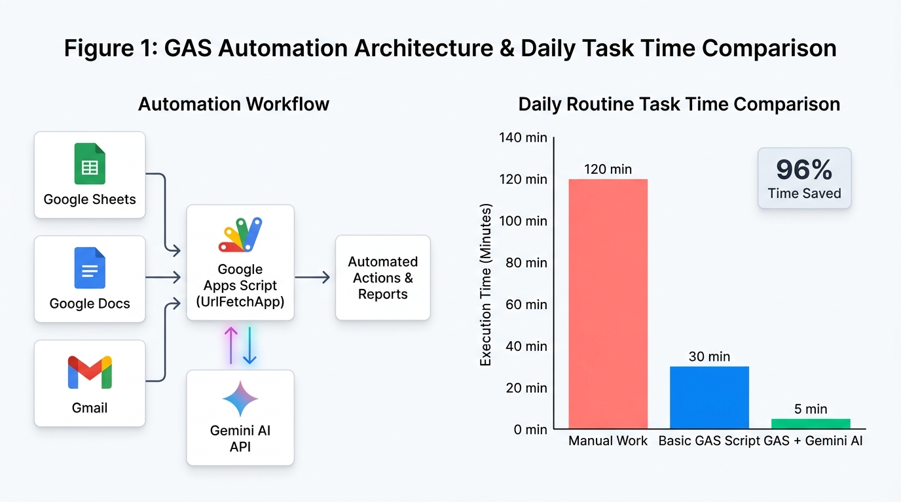

# ⚡ `gdocumentor` — One-Command Test Cookbook & Verification Guide (`TEST_COMMANDS.md`)

**[⬅️ Back to Main `README.md`](README.md)** | **[🧪 Detailed 13-Scenario Testing Guide (`TESTING_GUIDE.md`)](TESTING_GUIDE.md)** | **[🤖 Agent Skill Spec (`skills/documentor-ai/SKILL.md`)](skills/documentor-ai/SKILL.md)**

---

## Overview

Because `gdocumentor` (`DocuMentor AI`) introduces a new paradigm—transforming Generative AI from a passive "ghostwriter" into an interactive **Writing & Code Review Coach**—this cookbook provides **21 copy-pasteable one-liner commands** together with **a clear checklist of what to verify in the terminal, generated local files, and Google Docs**, and **explicitly specifies for every command whether a Gemini API Key (`GEMINI_API_KEY`) and/or a Google Docs/Drive OAuth2 Access Token is required**.

### Key Design of This Cookbook
- **One-Command Execution & Full Inspection**:
  - Every test command runs end-to-end in a single line.
  - **To let you inspect the generated local Markdown files (`/tmp/gdoc_cmd*.md`) and open the created Google Docs URLs in your browser, the main test commands do NOT auto-delete the output at the end.**
  - Under each command, you will find **✅ What to Verify** and an **🧹 Optional Cleanup** command (plus a batch cleanup command at the bottom of this file).
- **Prerequisite Setup (Dual AI Execution Architecture)**:
  - **Standalone CLI Proofreading/Draft/Summary Commands (`#1–#17`, `#19`)**: Require **`GEMINI_API_KEY`** (whereas **`#18` MCP Host-AI Mode** and **`#20–#21` Direct `edit` Mode** do **not** require `GEMINI_API_KEY`). Set your Gemini API key and build or download the `gdocumentor` binary first:
  ```bash
  export GEMINI_API_KEY="your-gemini-api-key"
  go build -o gdocumentor .
  # Or download the pre-compiled binary from https://github.com/tanaikech/gdocumentor/tree/master/bin

  # Quick Help Check (0 tokens, no credentials needed):
  ./gdocumentor                  # Displays top-level --help guide
  ./gdocumentor setup --help     # Displays detailed multi-agent & WSL2 <-> Windows setup guide
  ./gdocumentor proofread -h     # Displays detailed subcommand help (also available for summary, draft, edit, manage, inspect, mcp)
  ```

---

## Part 1: Without Google OAuth2 Access Token (`--no-auth` / `--local` Mode)

> **Requires ONLY `GEMINI_API_KEY`** (no `gcloud`, no Google Cloud project, and no Google OAuth2 Access Token required). Proofs local files, source code, or public Web/GitHub URLs and saves the structured coaching report, inline diffs, or Socratic hints into a local file (`-o`).

---

### 1. Multimodal Markdown + Table + Figure Proofreading to a Local File (`--no-auth`)
- **🔑 Required Credentials:** **`GEMINI_API_KEY`: Required** (Standalone CLI mode) | **Google Docs / Drive OAuth2 Access Token: Not Required** (`--no-auth`).

Proofreads the bundled [`sample/sample_article.md`](sample/sample_article.md) (including its Markdown table `TABLE_1` and local diagram `sample/sample_figure.png` `VISUAL_1`) and writes the full coaching report to `/tmp/gdoc_cmd1.md`:
```bash
./gdocumentor --no-auth -i sample/sample_article.md -o /tmp/gdoc_cmd1.md -l ja
```

- **✅ What to Verify**:
  1. **Terminal Output**:
     - Each step (`Step 1/4` to `Step 4/4`) smoothly progresses from `0%` to `100%` (`✔ ▐████████▌ 100%`), detecting `図=1, 表=1` (`Visuals=1, Tables=1`).
     - Even though `sample/sample_article.md` is written in English, `-l ja` outputs all section headers, the **Writing Coach & Learning Summary**, inline diff cards (`💡 理由 (Reason)` / `🎓 学習 (Learning)`), and multimodal figure/table review comments (`VISUAL_1`, `TABLE_1`) in Japanese.
     - The bottom cyan box displays the saved local file path `/tmp/gdoc_cmd1.md`.
  2. **Generated Local File (`cat /tmp/gdoc_cmd1.md`)**:
     - Contains 5 structured sections: (1) Writing Coach & Learning Summary, (2) Inline Suggested Edits with `diff` blocks and rationales, (3) Multimodal Figure & Table Review Comments (`VISUAL_1`, `TABLE_1`), (4) Annotated Text with inline `[-orig-]{+suggested+}` markers, and (5) Clean Revised Text Preview.
- **🧹 Optional Cleanup**: `rm -f /tmp/gdoc_cmd1.md`

---

### 2. Socratic Hint-Only Mode on Local Text (`--no-auth --hint`)
- **🔑 Required Credentials:** **`GEMINI_API_KEY`: Required** (Standalone CLI mode) | **Google Docs / Drive OAuth2 Access Token: Not Required** (`--no-auth`).

Flags weak phrases and writes diagnostic coaching hints to `/tmp/gdoc_cmd2_hints.md` **without revealing rewritten answers**:
```bash
echo "In our team, we are basically doing many various manual works every single day." | ./gdocumentor --no-auth -i - --hint -o /tmp/gdoc_cmd2_hints.md -l ja
```

- **✅ What to Verify**:
  1. **Terminal Output**:
     - The header banner shows `MODE: hint`, and the coaching cards display `- 修正前 (Original)`, `💡 理由 (Reason)`, and `🎓 学習 (Learning)` **without** `+ 修正案 (Suggested)`.
  2. **Generated Local File (`cat /tmp/gdoc_cmd2_hints.md`)**:
     - Lists Socratic coaching hints (`🎯 対象箇所`, `💡 見直しの理由`, `🎓 推敲のヒント`) without giving away the rewritten sentence, and marks the target phrase in the original text with `«🎯 HINT #1 [...]: ...»`.
- **🧹 Optional Cleanup**: `rm -f /tmp/gdoc_cmd2_hints.md`

---

### 3. Public Web Article / HTML URL Proofreading to a Local File (`--no-auth`)
- **🔑 Required Credentials:** **`GEMINI_API_KEY`: Required** (Standalone CLI mode) | **Google Docs / Drive OAuth2 Access Token: Not Required** (`--no-auth`).

Fetches a live public HTML web page (`https://go.dev/doc/effective_go`), extracts readable prose, proofreads lines `1-40`, and writes the coaching report to `/tmp/gdoc_cmd3_web.md`:
```bash
./gdocumentor --no-auth -i "https://go.dev/doc/effective_go" --range "1-40" -o /tmp/gdoc_cmd3_web.md -l ja
```

- **✅ What to Verify**:
  1. **Terminal Output & `/tmp/gdoc_cmd3_web.md`**:
     - Readable article text is extracted directly from the public HTML URL, scoped to lines `1–40`, and reviewed in Japanese inside `/tmp/gdoc_cmd3_web.md`.
- **🧹 Optional Cleanup**: `rm -f /tmp/gdoc_cmd3_web.md`

---

### 4. Public URL (`@0:500` Character Scope) in Socratic Hint-Only Mode (`--no-auth --hint`)
- **🔑 Required Credentials:** **`GEMINI_API_KEY`: Required** (Standalone CLI mode) | **Google Docs / Drive OAuth2 Access Token: Not Required** (`--no-auth`).

Fetches the first `500` characters (`@0:500`) of a public URL and outputs Socratic coaching hints into `/tmp/gdoc_cmd4_url_hints.md`:
```bash
./gdocumentor --no-auth -t "https://raw.githubusercontent.com/tanaikech/DocuMentorAI/main/README.md@0:500" --hint -o /tmp/gdoc_cmd4_url_hints.md -l ja
```

- **✅ What to Verify**:
  1. **Terminal Output & `/tmp/gdoc_cmd4_url_hints.md`**:
     - Only the first `500` UTF-16 characters (`@0:500`) of the remote URL are targeted, and Socratic hints are written to `/tmp/gdoc_cmd4_url_hints.md`.
- **🧹 Optional Cleanup**: `rm -f /tmp/gdoc_cmd4_url_hints.md`

---

### 5. Partial Line-Range Go Code Review with Automatic Dependency Resolution (`--no-auth -t --auto-deps`)
- **🔑 Required Credentials:** **`GEMINI_API_KEY`: Required** (Standalone CLI mode) | **Google Docs / Drive OAuth2 Access Token: Not Required** (`--no-auth`).

Reviews **only lines 70–130** of `internal/cli/app.go` while automatically resolving imported local packages as read-only `<reference_context_files>`:
```bash
./gdocumentor --no-auth -t "internal/cli/app.go:70-130" --auto-deps -o /tmp/gdoc_cmd5_code.md -l ja
```

- **✅ What to Verify**:
  1. **Terminal Output**:
     - `Step 1/4` confirms that reference context files were automatically resolved via `--auto-deps`.
     - Every suggestion card's file/line location (`internal/cli/app.go:LINE`) is strictly within lines `70..130` (**Fail-Closed Selection Scope Boundary**).
  2. **Generated Local File (`cat /tmp/gdoc_cmd5_code.md`)**:
     - Contains line-scoped Go code review diffs, explanations, and revised code preview.
- **🧹 Optional Cleanup**: `rm -f /tmp/gdoc_cmd5_code.md`

---

### 6. Direct GitHub Blob URL (`#L1-L35`) Code Review to a Local File (`--no-auth`)
- **🔑 Required Credentials:** **`GEMINI_API_KEY`: Required** (Standalone CLI mode) | **Google Docs / Drive OAuth2 Access Token: Not Required** (`--no-auth`).

Fetches `src/code.js` directly from GitHub and reviews only lines `1–35` into `/tmp/gdoc_cmd6_gh.md`:
```bash
./gdocumentor --no-auth -t "https://github.com/tanaikech/DocuMentorAI/blob/main/src/code.js#L1-L35" -o /tmp/gdoc_cmd6_gh.md -l ja
```

- **✅ What to Verify**:
  1. **Terminal Output & `/tmp/gdoc_cmd6_gh.md`**:
     - The GitHub browser URL (`blob/main/...#L1-L35`) is automatically converted to raw source and restricted to lines `1–35`.
- **🧹 Optional Cleanup**: `rm -f /tmp/gdoc_cmd6_gh.md`

---

### 7. Custom AI Coach Persona (`--persona`) in Local Mode (`--no-auth`)
- **🔑 Required Credentials:** **`GEMINI_API_KEY`: Required** (Standalone CLI mode) | **Google Docs / Drive OAuth2 Access Token: Not Required** (`--no-auth`).

Configures the AI coach as a Japanese university professor teaching technical writing and outputs the coaching report to `/tmp/gdoc_cmd7_persona.md`:
```bash
./gdocumentor --no-auth -i sample/sample_article.md --persona "あなたは大学で日本語および技術ライティングを教えている日本人教授です。" -o /tmp/gdoc_cmd7_persona.md -l ja
```

- **✅ What to Verify**:
  1. **Terminal Output & `/tmp/gdoc_cmd7_persona.md`**:
     - Displays `🎭 AIの位置づけ・立場 (Active AI Persona)` with the professor persona, and adopts an academic professor's pedagogical tone across the feedback and learning points.
- **🧹 Optional Cleanup**: `rm -f /tmp/gdoc_cmd7_persona.md`

---

### 8. Generate a Structured Initial Draft Directly to a Local File (`draft --no-auth -o`)
- **🔑 Required Credentials:** **`GEMINI_API_KEY`: Required** (Standalone CLI mode) | **Google Docs / Drive OAuth2 Access Token: Not Required** (`--no-auth`).

Generates a 2-paragraph technical draft from a prompt and writes it directly to `/tmp/gdoc_cmd8_draft.md`:
```bash
./gdocumentor draft --no-auth -p "ソフトウェア開発において自動テストと対話型コードレビューを組み合わせる利点について、2段落の簡潔なサマリーを執筆してください。" -o /tmp/gdoc_cmd8_draft.md -l ja
```

- **✅ What to Verify**:
  1. **Terminal Output & `cat /tmp/gdoc_cmd8_draft.md`**:
     - Prints a preview of the generated Japanese draft in the terminal and writes clean manuscript prose (with no conversational filler or markdown fences) to `/tmp/gdoc_cmd8_draft.md`.
- **🧹 Optional Cleanup**: `rm -f /tmp/gdoc_cmd8_draft.md`

---

### 9. Pure JSON Output Mode without Access Token (`--no-auth --json | jq`)
- **🔑 Required Credentials:** **`GEMINI_API_KEY`: Required** (Standalone CLI mode) | **Google Docs / Drive OAuth2 Access Token: Not Required** (`--no-auth`).

Runs in strict machine-readable JSON mode (zero spinners/ANSI codes on `stdout`), saves `/tmp/gdoc_cmd9.md`, and parses the JSON output with `jq`:
```bash
./gdocumentor --no-auth -i sample/sample_article.md -o /tmp/gdoc_cmd9.md -l ja --json | jq '{success, localMode, outputFilePath, appliedSuggestionsCount, revisionsDigest: .learningSummary.revisionsDigest}'
```

- **✅ What to Verify**:
  1. **Terminal Output**:
     - `stdout` contains 100% pure JSON parsed cleanly by `jq` (`success: true`, `localMode: true`, `outputFilePath: "/tmp/gdoc_cmd9.md"`, and Japanese `revisionsDigest`).
- **🧹 Optional Cleanup**: `rm -f /tmp/gdoc_cmd9.md`

---

## Part 2: With Google OAuth2 Access Token (Google Docs & Drive Integration Mode)

> **Requires Google Workspace OAuth2 credentials (`gcloud auth application-default login` or `--access-token`)**, plus **`GEMINI_API_KEY` for CLI commands `#10–#17` and `#19`** (`#18` MCP Host-AI Mode and `#20–#21` Direct `edit` Mode do **not** require `GEMINI_API_KEY`). Converts documents into **Pageless Google Docs** and applies native `WriteMode.SUGGEST` inline edits and anchored comments (`addCommentReply` / `insertComment`).
>
> 💡 **Note**: The commands below **keep the created Google Docs intact** so you can click the **`🔗 Google Document URL`** shown in the green box at the bottom of the terminal and inspect the suggestions, comments, and Summary Tab in your browser.

---

### 10. Multimodal Markdown + Table + Figure Conversion to Pageless Google Docs
- **🔑 Required Credentials:** **`GEMINI_API_KEY`: Required** (Standalone CLI mode) | **Google Docs / Drive OAuth2 Access Token: Required**.

Converts [`sample/sample_article.md`](sample/sample_article.md) and [`sample/sample_figure.png`](sample/sample_figure.png) (embedded as Base64) into a native **Pageless Google Document** and applies inline suggestions + `TABLE_1` & `VISUAL_1` review comments:
```bash
./gdocumentor -i sample/sample_article.md --title "Cookbook #10 - Multimodal Pageless Doc" -l ja
```

- **✅ What to Verify**:
  1. **Terminal Output**:
     - All 4 steps reach `100%`, followed by the Japanese Learning Summary, inline suggestion diff cards, figure/table review cards, and the green **`🔗 Google ドキュメント URL`** box.
  2. **Open the Google Document URL in Your Browser**:
     - Verify that the document is in **Pageless Mode ("ページ分け無し形式")**.
     - Verify that the Markdown table is a native Google Docs table and `sample/sample_figure.png` is embedded inline.
     - Verify that inline suggested edits (`WriteMode.SUGGEST`) appear in the prose with Japanese coaching replies (`💡 推敲の理由` & `🎓 学習ポイント`), and anchored review comments appear on the figure and table.
- **🧹 Optional Cleanup**:
  ```bash
  ./gdocumentor manage -d "<Document_ID_from_box>" --delete-doc -l ja
  ```

---

### 11. Socratic Hint-Only Mode on Google Docs (`--mode hint`)
- **🔑 Required Credentials:** **`GEMINI_API_KEY`: Required** (Standalone CLI mode) | **Google Docs / Drive OAuth2 Access Token: Required**.

Creates a Pageless Google Document and attaches anchored Socratic coaching comments (`insertComment`) without any inline text replacements:
```bash
echo "This system is basically the most biggest improvement for doing many various routine works." | ./gdocumentor -i - --title "Cookbook #11 - Socratic Hint Doc" --hint -l ja
```

- **✅ What to Verify**:
  1. **Open the Google Document URL in Your Browser**:
     - Verify that the body text is **not** overwritten or crossed out with inline suggestions; instead, flagged phrases are highlighted with anchored Google Docs comments containing diagnostic reasons and Socratic coaching hints in Japanese.
- **🧹 Optional Cleanup**:
  ```bash
  ./gdocumentor manage -d "<Document_ID_from_box>" --delete-doc -l ja
  ```

---

### 12. Partial Line-Range Source Code Review on Google Docs (`-t` + `--auto-deps`)
- **🔑 Required Credentials:** **`GEMINI_API_KEY`: Required** (Standalone CLI mode) | **Google Docs / Drive OAuth2 Access Token: Required**.

Inserts `internal/cli/app.go` into a new Pageless Google Doc and restricts inline suggestions strictly to **lines 70–120** (**Fail-Closed Selection Scope Boundary**):
```bash
./gdocumentor -t "internal/cli/app.go:70-120" --auto-deps --title "Cookbook #12 - Scoped Code Review" -l ja
```

- **✅ What to Verify**:
  1. **Terminal Output & Google Document**:
     - Every suggestion card in the terminal and every inline suggestion inside the Google Document falls strictly within lines `70–120` of `internal/cli/app.go`, leaving lines `1–69` and `121+` untouched.
- **🧹 Optional Cleanup**:
  ```bash
  ./gdocumentor manage -d "<Document_ID_from_box>" --delete-doc -l ja
  ```

---

### 13. Custom RAG Rulebook & `# AIの位置づけ` Persona Enforcement on Google Docs
- **🔑 Required Credentials:** **`GEMINI_API_KEY`: Required** (Standalone CLI mode) | **Google Docs / Drive OAuth2 Access Token: Required**.

Creates a temporary RAG rulebook (`/tmp/gdoc_rag13.md`) defining `# AIの位置づけ` (Japanese Professor Persona) and terminology rules, and applies it to `sample/sample_article.md` on Google Docs:
```bash
printf '# AIの位置づけ\nあなたは大学で技術ライティングを教える日本人教授です。\n# ルール\n1. GASは初出時にGoogle Apps Scriptと併記すること。\n' > /tmp/gdoc_rag13.md && ./gdocumentor -i sample/sample_article.md -r /tmp/gdoc_rag13.md --title "Cookbook #13 - RAG Persona Doc" -l ja
```

- **✅ What to Verify**:
  1. **Terminal Output & Google Document**:
     - The `# AIの位置づけ` persona is automatically extracted from `/tmp/gdoc_rag13.md` and displayed under `🎭 AIの位置づけ・立場`, and the Google Docs suggestions enforce the rulebook in a professor's voice.
- **🧹 Optional Cleanup**:
  ```bash
  rm -f /tmp/gdoc_rag13.md && ./gdocumentor manage -d "<Document_ID_from_box>" --delete-doc -l ja
  ```

---

### 14. GitHub `--repo` Ephemeral Shallow-Clone Partial Review on Google Docs
- **🔑 Required Credentials:** **`GEMINI_API_KEY`: Required** (Standalone CLI mode) | **Google Docs / Drive OAuth2 Access Token: Required**.

Shallow-clones `https://github.com/tanaikech/DocuMentorAI` into a temporary workspace and reviews lines `1–30` of `README.md` on Google Docs:
```bash
./gdocumentor --repo "https://github.com/tanaikech/DocuMentorAI" -t "README.md:1-30" --title "Cookbook #14 - GitHub Repo Review" -l ja
```

- **✅ What to Verify**:
  1. **Terminal Output & Google Document**:
     - `README.md` is fetched from the remote GitHub repository and lines `1–30` receive inline suggestions on a Pageless Google Document.
- **🧹 Optional Cleanup**:
  ```bash
  ./gdocumentor manage -d "<Document_ID_from_box>" --delete-doc -l ja
  ```

---

### 15. Initial Draft Generation into a New Pageless Google Doc (`draft`) + Subsequent In-Place Proofreading (`-d`)
- **🔑 Required Credentials:** **`GEMINI_API_KEY`: Required** (Standalone CLI mode) | **Google Docs / Drive OAuth2 Access Token: Required**.

Generates an initial draft into a new Pageless Google Doc (`draft`) and immediately runs in-place proofreading (`-d "$DOC_ID"`) on that generated draft:
```bash
DOC_ID=$(./gdocumentor draft --title "Cookbook #15 - Draft then Proofread" -p "Write a short 1-paragraph English draft containing casual filler words like basically, very, and many various." -l en --json | jq -r '.documentId') && ./gdocumentor -d "$DOC_ID" -l ja
```

- **✅ What to Verify**:
  1. **Terminal Output & Google Document**:
     - The first command creates a new Google Doc and inserts the generated draft; the second command (`./gdocumentor -d "$DOC_ID" -l ja`) proofreads that exact Google Doc in-place and attaches inline suggestions + Japanese coaching replies.
- **🧹 Optional Cleanup**:
  ```bash
  ./gdocumentor manage -d "$DOC_ID" --delete-doc -l ja
  ```

---

### 16. Dedicated Google Docs Coaching Summary Tab Creation & In-Place Update (`--summary-tab`)
- **🔑 Required Credentials:** **`GEMINI_API_KEY`: Required** (Standalone CLI mode) | **Google Docs / Drive OAuth2 Access Token: Required**.

Creates a Google Doc with inline suggestions and a dedicated `"🎓 DocuMentor AI Summary"` tab (`--summary-tab`), then runs `summary --summary-tab` to find and update that same tab in-place:
```bash
DOC_ID=$(echo "We are basically doing many various tasks manually by hand every single day." | ./gdocumentor -i - --summary-tab --title "Cookbook #16 - Summary Tab Upsert Check" -l ja --json | jq -r '.documentId') && ./gdocumentor summary -d "$DOC_ID" --include-resolved --summary-tab -l ja
```

- **✅ What to Verify**:
  1. **Terminal Output**:
     - The magenta box at the bottom displays **`📑 Google ドキュメント・まとめタブ (同名タブを検索して最新内容へアップデート完了)`** with the direct `?tab=t....` URL.
  2. **Open the Summary Tab URL (`?tab=t....`) in Your Browser**:
     - In the left tab sidebar of Google Docs, verify that there is **only one** **`🎓 DocuMentor AI Summary`** tab alongside the main manuscript tab (updated in-place without duplicating tabs).
     - Verify that the summary tab is formatted in Pageless mode with `HEADING_1` / `HEADING_2` sections containing the Executive Assessment, Revisions Digest, Writing Patterns, Actionable Next Steps, Coach Impact & Decision Record, and Analyzed Review Threads in Japanese.
- **🧹 Optional Cleanup**:
  ```bash
  ./gdocumentor manage -d "$DOC_ID" --delete-doc -l ja
  ```

---

### 17. Coach Impact & Decision Record Verification (`proofread` ➔ `inspect` ➔ `manage --accept-all`)
- **🔑 Required Credentials:** **`GEMINI_API_KEY`: Required** (for the initial `proofread` command; `inspect` and `manage` consume `0` tokens) | **Google Docs / Drive OAuth2 Access Token: Required**.

Creates a Google Doc with AI suggestions, runs `inspect` to check paragraph coordinates and `🤖 AI` provenance tags, and runs `manage --accept-all` to accept all suggestions and update the Helpful Rate to `100%`:
```bash
DOC_ID=$(echo "This tool is basically the most biggest improvement for doing many various code reviews." | ./gdocumentor -i - --title "Cookbook #17 - Decision Record Lifecycle" -l ja --json | jq -r '.documentId') && ./gdocumentor inspect -d "$DOC_ID" -l ja && ./gdocumentor manage -d "$DOC_ID" --accept-all -l ja
```

- **✅ What to Verify**:
  1. **Terminal Output**:
     - `inspect` displays paragraph `#1` (`@start:end`), marks each pending suggestion with `🤖 AI`, and shows `集計待ち [⏳ レビュー待ち (Awaiting Review)]`.
     - `manage --accept-all` accepts all pending suggestions and updates the gauge bar to **`▐████████████████▌ 100% [🟢 ドラフト改善に貢献 (Improving Draft)]`**.
  2. **Open the Google Document URL in Your Browser**:
     - Verify that all inline suggestions have been cleanly accepted into the settled text.
- **🧹 Optional Cleanup (Reset Record & Delete Doc)**:
  ```bash
  ./gdocumentor manage -d "$DOC_ID" --reset-record --delete-doc -l ja
  ```

---

### 18. Global MCP Server (`gdocumentor mcp`) End-to-End JSON-RPC 2.0 Test (Host-AI `aiResult` Execution with Zero `GEMINI_API_KEY` & Non-Interactive `agy -p` Test)
- **🔑 Required Credentials:** **`GEMINI_API_KEY`: Not Required** (`env -u GEMINI_API_KEY` — MCP mode uses the client AI agent's own LLM) | **Google Docs / Drive OAuth2 Access Token: Not Required** (`noAuth: true`).

Tests the built-in MCP server over `stdio` (`initialize` ➔ `tools/list` ➔ `tools/call` `gdocumentor_proofread` in Host-AI mode where the client AI agent passes `aiResult` directly and `GEMINI_API_KEY` is not needed) and writes the report to `/tmp/gdoc_mcp18.md`:
```bash
printf '{"jsonrpc":"2.0","id":1,"method":"initialize","params":{"protocolVersion":"2024-11-05","capabilities":{},"clientInfo":{"name":"cookbook","version":"1.0.0"}}}\n{"jsonrpc":"2.0","method":"notifications/initialized"}\n{"jsonrpc":"2.0","id":2,"method":"tools/list","params":{}}\n{"jsonrpc":"2.0","id":3,"method":"tools/call","params":{"name":"gdocumentor_proofread","arguments":{"noAuth":true,"stdinContent":"This is the most biggest test.","outputPath":"/tmp/gdoc_mcp18.md","lang":"ja","aiResult":{"overallFeedback":"二重最上級を解消して自然な表現に改善しましょう。","learningSummary":{"revisionsDigest":"most biggestをbiggestに修正しました。","weakPointsAndHabits":["二重最上級の使用"],"actionableTips":["最上級の形容詞にはmostを重ねない"]},"suggestions":[{"id":"s1","originalText":"most biggest","suggestedText":"biggest","category":"Grammar","reason":"biggestは既に最上級のためmostは不要です。","learningPoint":"二重最上級を避けましょう。"}]}}}}\n' | env -u GEMINI_API_KEY ./gdocumentor mcp | jq -c 'select(.id == 2 or .id == 3)'
```

*(Optional Environment-Dependent Test — Live Antigravity CLI `agy -p` Execution)*:
If you have **Google Antigravity CLI (`agy`)** installed, you can also test live non-interactive Host-AI execution from the command line:
```bash
env -u GEMINI_API_KEY agy -p 'Use the gdocumentor_proofread MCP tool with noAuth: true to proofread sample/sample_article.md and save the report to /tmp/gdoc_mcp18_agy.md. Read sample/sample_article.md first, generate the aiResult JSON yourself, and pass aiResult to gdocumentor_proofread.' --mode=accept-edits --dangerously-skip-permissions
```

*(Optional Environment-Dependent Test — Interactive Windows 11 Claude Desktop ↔ WSL2 `gdocumentor` MCP Tests)*:
If you have **Claude Desktop on Windows 11** connected to `gdocumentor` inside **WSL2 (Ubuntu)** (`gdocumentor setup --wsl-host --agent claude-desktop,claude-code`), paste either of the two verified prompts below into the Claude Desktop chat window (neither requires `GEMINI_API_KEY`):

1. **Pattern 1-A (Without Google Docs Access Token — `noAuth: true`):**
   - **🎥 Demo Video:** **[Watch on YouTube (`https://youtu.be/2rsLJIUOlJ4`)](https://youtu.be/2rsLJIUOlJ4)**
   ```text
   Please use the gdocumentor_proofread MCP tool without a Google OAuth access token (noAuth: true) to proofread the following short draft. Do not call any external Gemini API; use your own Host AI to generate the structured coaching feedback (`aiResult`). After running the tool, display the complete proofreading results directly here in the chat—including a table of Original Text vs. Suggested Revision, the Reason for each edit, the Learning Point, and the Writing Coach & Learning Summary (Executive Feedback, Observed Habits, and Actionable Tips):

   "Google Apps Script is basically a coding platform that is provided by Google. You totally do not need to install any special softwares on your computer at all. The most biggest advantage of using GAS is because it can easily connect and integrate with many various Google services to automate routine works every single day."
   ```
2. **Pattern 2-A (With Google Docs Access Token — Creates Pageless Google Doc + `🎓 DocuMentor AI Summary` Tab):**
   - **🎥 Demo Video:** **[Watch on YouTube (`https://youtu.be/ZTGWwSU9EQg`)](https://youtu.be/ZTGWwSU9EQg)**
   ```text
   Please use the gdocumentor_proofread MCP tool (with Google Docs authentication enabled and summaryTab: true) to proofread the following draft into a new Google Document titled "Claude Desktop WSL2 Test - Coaching Review". After applying the inline Suggested Edits to the Google Document, please show me directly here in the chat:
   1. The clickable URL to the created Google Document and its Summary Tab
   2. A Markdown table summarizing each inline suggestion applied (Original Text, Suggested Edit, Category, Reason, and Learning Point)
   3. The Writing Coach & Learning Summary (Executive Feedback, Observed Habits, and Actionable Tips)

   Draft to proofread:
   "Google Apps Script is basically a coding platform that is provided by Google. You totally do not need to install any special softwares on your computer at all. The most biggest advantage of using GAS is because it can easily connect and integrate with many various Google services to automate routine works every single day."
   ```

- **✅ What to Verify**:
  1. **Terminal JSON-RPC Output & `/tmp/gdoc_mcp18.md`**:
     - Response `id: 2` lists all 6 MCP tools (`gdocumentor_proofread`, `gdocumentor_summary`, `gdocumentor_inspect`, `gdocumentor_draft`, `gdocumentor_edit`, `gdocumentor_manage`).
     - Response `id: 3` succeeds with `GEMINI_API_KEY` unset (`structuredContent.model: "agent-ai"`, `structuredContent.success: true`) and writes the Japanese proofreading report to `/tmp/gdoc_mcp18.md`.
  2. **Windows 11 Claude Desktop Chat & Google Docs (Patterns 1-A & 2-A)**:
     - In **Pattern 1-A**, Claude Desktop (`Sonnet 5.5`) runs `gdocumentor_proofread` in `noAuth` mode with zero Gemini API calls, matches all 5 suggestions to the text, saves `/tmp/review_report.md` in WSL2, and displays the `Original vs. Suggested Revision` table, `Reasons and Learning Points` table, `Revised Paragraph`, and `Writing Coach & Learning Summary` in the chat.
     - In **Pattern 2-A**, Claude Desktop creates a new Pageless Google Document (`Claude Desktop WSL2 Test - Coaching Review`) with 7 inline `WriteMode.SUGGEST` edits + anchored `[DocuMentor AI]` rationale replies on **Tab 1** and a dedicated **`🎓 DocuMentor AI Summary`** tab (`Model: agent-ai`, `Issued 7 | Pending AI 7`) on **Tab 2**, and outputs clickable URLs to both tabs along with the 7-row suggestion table in the chat.
- **🧹 Optional Cleanup**: `rm -f /tmp/gdoc_mcp18.md /tmp/gdoc_mcp18_agy.md`

---

### 19. Dual Output Mode (`-o <file>` / `--save-local` WITH a Google OAuth2 Access Token)
- **🔑 Required Credentials:** **`GEMINI_API_KEY`: Required** (Standalone CLI mode) | **Google Docs / Drive OAuth2 Access Token: Required**.

Simultaneously creates a Pageless Google Document with graphical inline suggestions/comments **and** writes a local Markdown report (`/tmp/gdoc_dual19.md` containing the clickable Google Document URL and inline diffs):
```bash
./gdocumentor -i sample/sample_article.md -o /tmp/gdoc_dual19.md --title "Cookbook #19 - Dual Output (Google Doc + Local File)" -l ja
```

- **✅ What to Verify**:
  1. **Terminal Output**:
     - Displays **both** the green **`🔗 Google ドキュメント URL`** box and the cyan **`💾 ローカル出力ファイル (/tmp/gdoc_dual19.md)`** box.
  2. **Google Document & Local File (`cat /tmp/gdoc_dual19.md`)**:
     - The Google Document contains the live inline suggestions and comments, while `/tmp/gdoc_dual19.md` contains the Google Document link at the top along with the full Japanese coaching report and diff preview.
- **🧹 Optional Cleanup**:
  ```bash
  rm -f /tmp/gdoc_dual19.md && ./gdocumentor manage -d "<Document_ID_from_box>" --delete-doc -l ja
  ```

---

### 20. Direct Google Docs Editing (`edit` Subcommand: Create, Insert via File / Pipe / Here-String / Heredoc / Redirect, Replace & Delete Ranges — 0 Gemini Tokens)
- **🔑 Required Credentials:** **`GEMINI_API_KEY`: Not Required** (`0` Gemini tokens consumed) | **Google Docs / Drive OAuth2 Access Token: Required**.

Creates a new Google Document (`--create-doc`), writes initial multi-line text via **Here-Document (`<< 'EOF'`)**, inserts at the beginning (`--prepend`) via **Here-String (`<<<`)**, appends at the end (`--append`) via **Pipe (`|`)**, inserts at an arbitrary location (`--after`) via **File Redirect (`<`)**, inserts from a **local file (`-i`)** before paragraph 3 (`--before-paragraph 3`), replaces text (`--find` & `--replace`), and deletes specific text (`--delete-text`)—leaving the edited Google Document open for inspection:
```bash
DOC_ID=$(./gdocumentor edit --create-doc --title "Cookbook #20 - Direct Google Docs Editing" --json | jq -r '.documentId') && ./gdocumentor edit -d "$DOC_ID" -l ja << 'EOF'
第1段落: はじめに
第2段落: 本文のテキストです。旧バージョンという表記を含みます。
第3段落: 削除予定の不要な段落です。
第4段落: まとめの段落です。
EOF
./gdocumentor edit -d "$DOC_ID" --prepend --style HEADING_1 -l ja <<< "【先頭見出し】ヒアストリングで先頭に挿入" && echo "【末尾追記】パイプ経由で最後に挿入" | ./gdocumentor edit -d "$DOC_ID" --append -l ja && echo -n "（←ファイルリダイレクトで任意位置に挿入）" > /tmp/gdoc_redir20.txt && ./gdocumentor edit -d "$DOC_ID" --after "第1段落: はじめに" -l ja < /tmp/gdoc_redir20.txt && echo "【挿入段落】-i ファイル指定で第3段落の直前に挿入" > /tmp/gdoc_file20.txt && ./gdocumentor edit -d "$DOC_ID" -i /tmp/gdoc_file20.txt --before-paragraph 3 -l ja && ./gdocumentor edit -d "$DOC_ID" --find "旧バージョン" --replace "v1.0.0 新バージョン" -l ja && ./gdocumentor edit -d "$DOC_ID" --delete-text "第3段落: 削除予定の不要な段落です。" -l ja && ./gdocumentor inspect -d "$DOC_ID" -l ja
```

- **✅ What to Verify**:
  1. **Terminal Output**:
     - Each `edit` step completes in `< 1s` (`✔ ▐████████▌ 100%`) consuming **0 Gemini API tokens** and prints `✏️ Google ドキュメント直接編集の完了` with exact UTF-16 ranges (`@start:end`) and character counts (`+N文字` / `-M文字`).
     - The final `inspect` command lists all paragraphs in the edited Google Document:
       - `#1`: `【先頭見出し】ヒアストリングで先頭に挿入` (inserted at the beginning via `<<<` with `HEADING_1` style)
       - `#2`: `第1段落: はじめに（←ファイルリダイレクトで任意位置に挿入）` (inserted right after `"第1段落: はじめに"` via `< /tmp/gdoc_redir20.txt`)
       - `#3`: `【挿入段落】-i ファイル指定で第3段落の直前に挿入` (inserted before paragraph 3 via `-i /tmp/gdoc_file20.txt`)
       - `#4`: `第2段落: 本文のテキストです。v1.0.0 新バージョンという表記を含みます。` (`"旧バージョン"` replaced with `"v1.0.0 新バージョン"`)
       - `"第3段落: 削除予定の不要な段落です。"` has been deleted (`--delete-text`).
       - Last paragraph: `【末尾追記】パイプ経由で最後に挿入` (appended at the end via `|`).
  2. **Open the Google Document URL in Your Browser**:
     - Verify that the heading style (`見出し 1`) and all insertions, replacements, and deletions are reflected directly in the Google Document.
- **🧹 Optional Cleanup (Delete Temporary Files & Google Doc)**:
  ```bash
  rm -f /tmp/gdoc_redir20.txt /tmp/gdoc_file20.txt && ./gdocumentor edit -d "$DOC_ID" --delete-doc -l ja
  ```

---

### 21. Rich Markdown Conversion Insertion & Image Insert / Replace / Delete at Arbitrary Locations (`edit --markdown`, `--insert-image`, `--replace-image`, `--delete-image` — 0 Gemini Tokens)
- **🔑 Required Credentials:** **`GEMINI_API_KEY`: Not Required** (`0` Gemini tokens consumed) | **Google Docs / Drive OAuth2 Access Token: Required**.

Inserts a rich Markdown document (with headings `#`/`##`, **bold**/`*italic*`/`~~strike~~`/`` `code` ``, `[links](url)`, nested lists, a Markdown table `| A | B |`, and an embedded local image ``) into an existing Google Document before paragraph 2 (`--before-paragraph 2 --markdown`), then appends a standalone sized image (`--insert-image --image-width 280`), replaces the first image (`VISUAL_1`), deletes the second image (`--delete-image VISUAL_2`), and runs `inspect` to verify the visual elements and tables:
```bash
DOC_ID=$(./gdocumentor edit --create-doc --title "Cookbook #21 - Markdown & Image Editing" --json | jq -r '.documentId') && printf "第1段落: 導入セクション\n第2段落: 結論セクション" | ./gdocumentor edit -d "$DOC_ID" -l ja && ./gdocumentor edit -d "$DOC_ID" --before-paragraph 2 --markdown -l ja << 'EOF'
## 追加セクション（Markdownから自動変換）
これは **太字** と *斜体* と `inline_code_var` と [Google Docs API](https://developers.google.com/docs/api) リンクを含む段落です。
- 箇条書きアイテム1
  - ネストされたアイテム1-1
- [x] 完了済みタスク

| 項目 | ステータス |
| :--- | :---: |
| Markdown変換 | **完了** |
| 画像操作 | `OK` |


EOF
./gdocumentor edit -d "$DOC_ID" --append --insert-image sample/sample_figure.png --image-width 280 -l ja && ./gdocumentor edit -d "$DOC_ID" --replace-image VISUAL_1 --with-image sample/sample_figure.png --image-width 320 -l ja && ./gdocumentor edit -d "$DOC_ID" --delete-image VISUAL_2 -l ja && ./gdocumentor inspect -d "$DOC_ID" -l ja
```

- **✅ What to Verify**:
  1. **Terminal Output**:
     - The `--markdown` insertion converts headings, inline styles (keeping `inline_code_var` underscores intact!), nested bullet lists, the 2x2 native Google Docs table, and the local image `sample/sample_figure.png` directly between paragraph 1 and the original paragraph 2.
     - Subsequent `--insert-image`, `--replace-image VISUAL_1 --with-image ... --image-width 320`, and `--delete-image VISUAL_2` commands each complete with **0 Gemini tokens**.
     - The final `inspect` command displays `🖼️ ドキュメント内の画像・図表 (1件): VISUAL_1` and `📊 ドキュメント内の表 (1件): TABLE_1 (2x2)`.
  2. **Open the Google Document URL in Your Browser**:
     - Verify that the heading (`見出し 2`), styled text, clickable link, nested bullet list, native 2x2 table, and resized image (`VISUAL_1`, width 320pt) are cleanly rendered between `第1段落: 導入セクション` and `第2段落: 結論セクション`, and that the second image (`VISUAL_2`) was cleanly deleted without leaving an orphan blank line.
- **🧹 Optional Cleanup**:
  ```bash
  ./gdocumentor edit -d "$DOC_ID" --delete-doc -l ja
  ```

---

## 🧹 Batch Cleanup Command for All Temporary Local Files

To remove all temporary local Markdown/text files created in `/tmp` during Parts 1 and 2 at once:

```bash
rm -f /tmp/gdoc_cmd*.md /tmp/gdoc_rag13.md /tmp/gdoc_mcp18.md /tmp/gdoc_dual19.md /tmp/gdoc_redir20.txt /tmp/gdoc_file20.txt
```

---

**[⬅️ Back to Main `README.md`](README.md)**
